# Arkom — mapa completo da Bia

Documento para importar ou colar no Obsidian. Cada bloco `mermaid` funciona de forma independente; o primeiro dá a visão de cima e os demais abrem os caminhos.

Base: implementação e configuração consultadas no servidor em **29/10/2026**, incluindo o case Camozzi, especialistas de texto com Decisions e aviso por WhatsApp no início da reunião. O mapa descreve os caminhos implementados; isso não significa que todos foram homologados em atendimento real.

**Como ler:** decisões aparecem em losangos. Estados finais de uma etapa podem voltar à conversa quando houver uma nova mensagem. Trechos explicitamente marcados como desligados, dependentes de evento ou propostos não devem ser tratados como automações ativas.

## 1. Visão de cima — jornada do cliente

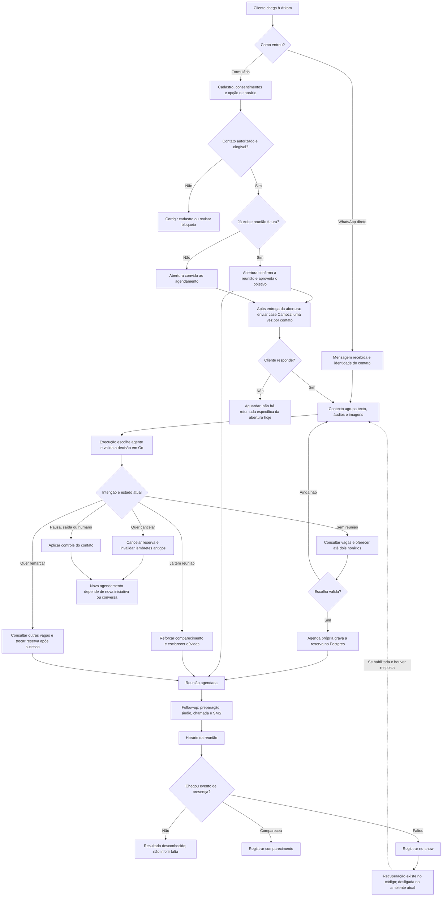

O bloco de cadência é independente de o cliente responder à primeira mensagem. **Entretanto, áudio e convite de ligação exigem uma resposta recente no WhatsApp**, além de reserva válida. O SMS usa autorização própria e não depende dessa janela.

## 2. O que está ligado hoje

| Caminho | Situação observada no servidor |
|---|---|
| Contato automático após formulário | Ativo; abertura tem espera de 10 segundos para incorporar a reserva |
| Case Camozzi logo após a abertura | Ativo no worker de mídia; uma vez por contato; template aprovado; aguarda entrega da abertura |
| Agendar no formulário e enxergar no WhatsApp | Ativo; há reserva no mesmo pedido ou em chamada posterior |
| Texto, áudio, imagem e agrupamento de mensagens | Ativos |
| Especialistas de texto com Decisions | Persuasão, objeções, agenda, comparecimento e recuperação; memória compartilhada e prompts próprios |
| Preparação 15 minutos após a abertura | Ativa, com horário permitido e validade curta |
| Áudio 30 minutos antes | Ativo, usando a gravação instalada |
| Texto e solicitação de ligação 15 minutos antes | Ativos, condicionados à janela e à permissão |
| SMS 5 minutos antes | Ativo, com `sms_consent: true` |
| WhatsApp no início | Etapa própria em T, expira em T+5; CONFIRMO ou REMARCAR; template fora da sessão |
| Botões de áudio, chamada e SMS da demonstração | Ativos; antecipam a execução sem alterar a reunião |
| Retomada 2 horas após oferta sem resposta | Implementada; desligada por `BIA_DISABLE_FOLLOWUPS=true` |
| Recuperação após no-show | Implementada; envio desligado pela mesma configuração |
| Lembretes clássicos em T−24h, T−2h e T−15min | Caminho alternativo do código; substituído pela cadência atual |
| Detectar comparecimento ou falta automaticamente | Não implementado; depende de evento informado |
| Link de reunião | Não configurado; a Bia não deve inventá-lo |
| Marcar, remarcar ou cancelar pela ligação | Não permitido; a ligação apenas consulta e registra notas |
| Nova tentativa automática depois de `busy` ou `no-answer` | Não há uma sequência de rediscagem implementada |

A agenda está configurada para reuniões de **45 minutos**, todos os dias, nas janelas **08:00–12:00 e 14:00–20:00**, com geração de 14 dias. A grade é gerada em `America/Cuiaba`; a apresentação ao cliente usa o fuso informado no cadastro. Há antecedência mínima de 30 minutos.

## 3. Formulário, identidade e primeira mensagem

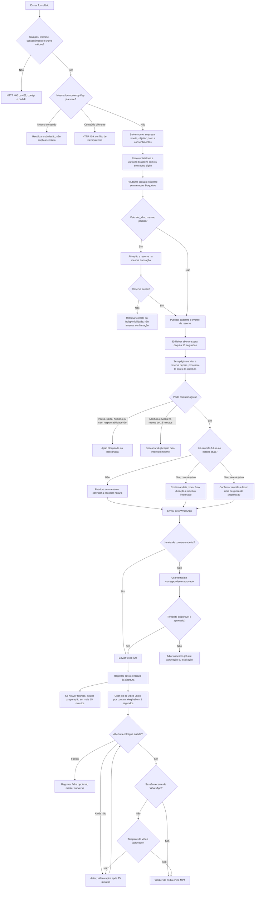

**Detalhes que mudam a jornada:**

- Receita zero ou desconhecida não impede atendimento nem agendamento.
- O consentimento de SMS é separado do consentimento de contato no WhatsApp. Nova submissão sem `sms_consent: true` retira essa opção quando o perfil é atualizado.
- A espera de 10 segundos acomoda o formulário que agenda em uma segunda chamada. A reserva enviada no mesmo pedido é a opção transacional; uma segunda chamada que demore mais pode chegar depois da abertura.
- Quando a abertura já confirmou a reserva atual, a confirmação separada da agenda é descartada para não duplicar a mensagem.
- Novo formulário não remove opt-out, pausa nem atendimento humano. Repetição com nova chave também passa pelo intervalo mínimo entre aberturas.
- O vídeo não exige reserva; exige contato liberado. Não é reenviado a cada formulário, resposta ou retomada. Falhas no vídeo não colocam o WhatsApp em atendimento humano. Consulte [o contrato do vídeo](intro-video.md).
- Há um caminho legado de pareamento por link/código e uma API interna de cadastro. No servidor atual, o formulário público está em contato automático.

## 4. WhatsApp, mensagens picadas, mídia e memória

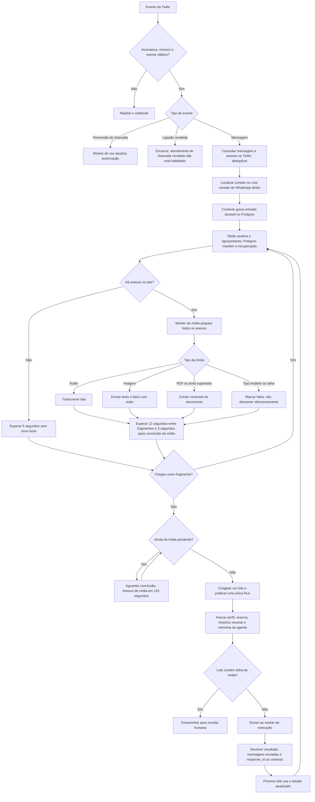

A espera máxima normal de agrupamento é **30 segundos** desde o início do lote. Mídia ainda em processamento e a pequena espera após sua conclusão podem prolongar esse período. O lote tem limites de tamanho; excesso é separado em outra execução ou sinalizado para revisão.

O contexto usa até 20 mensagens e 24.000 bytes de histórico recente por janela, com limites adicionais para o lote. O `previous_response_id` é separado por especialidade e conversa. A referência é renovada quando ultrapassa 20 horas, 8 elos ou 16.000 tokens de entrada; o histórico recente continua disponível. Não há resumo semântico automático implementado nessa rotação.

O indicador de digitação é uma tentativa com controle de frequência, não uma confirmação de entrega. A resposta pode sair em até três partes, com pausas de 2 a 4 segundos. Se chegar nova entrada, as partes antigas ainda pendentes podem ser descartadas para evitar respostas fora de contexto.

## 5. Agentes de texto e motor de decisões

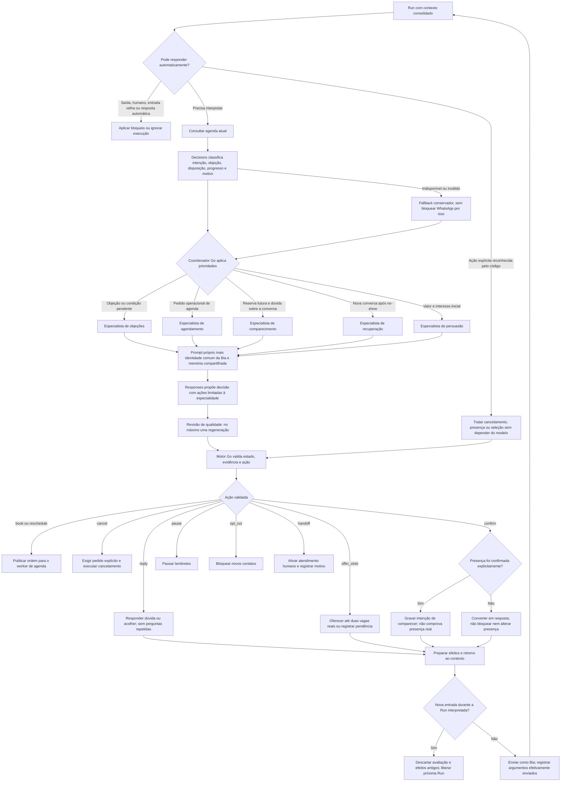

| Especialidade atual | Quando entra | Objetivo |
|---|---|---|
| `persuasion` | Interesse inicial ou dúvida de valor sem barreira concreta | Relacionar o objetivo à reunião e facilitar o próximo passo |
| `objections` | Barreira de adequação, tempo, investimento, confiança, sócio ou formato | Esclarecer o motivo e tratar a barreira sem repetir argumentos |
| `scheduling` | Intenção de consultar vagas, escolher ou alterar reserva | Transformar escolha clara em ordem de agenda validada |
| `attendance` | Reserva futura, preparação e dúvidas sobre a reunião | Sustentar comparecimento e preservar a reserva atual |
| `recovery` | Estado `no_show` informado | Acolher a ausência e facilitar nova escolha, se houver conversa |
| Voz de lembrete | Chamada autorizada vinculada a reunião existente | Lembrar, consultar dados e registrar nota; prompt próprio |
| Extração de mídia | Anexo recebido | Produzir conteúdo de referência; não toma ações comerciais |

Os cinco especialistas têm **prompts próprios**, com uma especialidade escolhida por Run e identidade comum da Bia. Decisions faz a leitura, o Go escolhe a rota e Responses escreve a resposta. Histórico e memória comercial são compartilhados; os response IDs são separados e versionados por especialista. Ter o envio de recuperação desligado não impede selecionar `recovery` numa nova conversa de quem tem no-show informado. Consulte [contratos e limites](specialists.md).

Se já há reunião futura, o atendimento prioriza comparecimento e dúvidas. Sem reunião, objetivo conhecido e aceite bastam para oferecer horários. Se o objetivo estiver ausente, o prompt permite uma pergunta curta; não exige site, equipe ou nova rodada de faturamento. Pedido explícito de remarcação abre novamente a consulta de vagas.

## 6. Agenda — escolha, reserva, remarcação e cancelamento

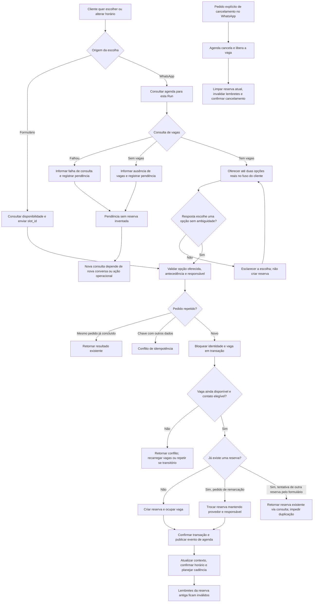

No formulário público, uma tentativa de novo agendamento com reserva ativa é rejeitada; o endpoint `/test-status` permite recuperar a reserva atual. A remarcação conversacional usa a reserva antiga como parte da operação. A aplicação não deve anunciar uma alteração antes do sucesso da agenda. A reserva antiga é preservada se a transação de remarcação não concluir.

Há proteções adicionais para contextos de reuniões em grupo e troca de responsável/provedor. A configuração atual é individual e usa a agenda local; situações incompatíveis vão para revisão humana. A existência de adaptadores antigos no repositório não significa que n8n, Cal ou ClickMax participem desta configuração.

## 7. Todos os follow-ups e seus relógios

**T0** = envio bem-sucedido da abertura do formulário. **T** = início real da reunião na reserva atual. Preparação depois de T0 e lembretes antes de T são relógios diferentes.

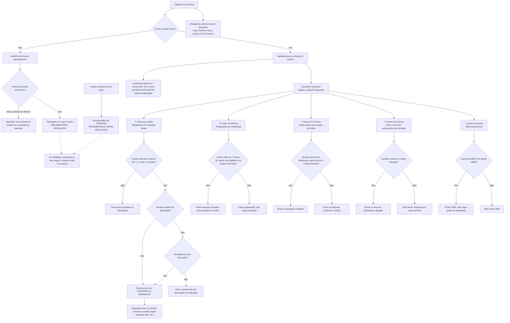

| Etapa | Quando fica elegível | Janela e condições principais | Conteúdo e responsável |
|---|---|---|---|
| Abertura | Cerca de 10s após ativar formulário público | Cadastro elegível; template aprovado fora da sessão; validade de 24h; intervalo mínimo entre aberturas de 15min | Execução envia texto/template montado com perfil e reserva |
| Vídeo Camozzi | Elegível 2s após o envio da abertura | Aguarda entrega da abertura; vence em 15min; contato liberado; template de vídeo fora da sessão | Mídia envia o MP4 instalado, uma vez por contato |
| Confirmação de reserva | Após sucesso da agenda | Antes do início da reunião; aguarda janela de WhatsApp se não foi coberta pela abertura | Worker de agenda; não é uma nova geração livre de horários |
| Preparação | T0 + 15min | Só se há reunião; vence após 5min ou em T−30, o que ocorrer primeiro; respeita horário permitido | Follow-up envia texto/template de preparação, sem depoimento |
| Áudio | T−30min | Vence em T−25; sessão recente de WhatsApp, consentimento e arquivo pronto; horário permitido | Follow-up encaminha; mídia envia a gravação existente |
| Convite/chamada | T−15min | Texto e início do pedido de permissão até T−10; chamada depende de permissão e reunião ainda futura | Follow-up envia texto; voz trata autorização e chamada |
| WhatsApp no início | T | Expira em T+5 ou no fim da reserva; contato liberado; template aprovado fora da sessão | Follow-up envia texto determinístico com CONFIRMO ou REMARCAR |
| SMS | T−5min | Até T; autorização específica, celular válido e canal configurado; não depende de sessão nem do horário comercial | Follow-up envia texto determinístico por Twilio SMS |
| Retomada de oferta | Oferta + 2h, ajustada ao horário permitido | Desligada hoje; quando ligada, requer a mesma oferta atual, nenhuma reserva e limite de uma retomada em 24h | Follow-up envia texto de retomada; não é uma sequência diária infinita |
| Lembretes clássicos | T−24h, T−2h, T−15min | Alternativa quando a cadência de reunião está desligada; não roda em paralelo com ela | Follow-up de texto; também afetado pelo bloqueio de retomadas gerais |
| Recuperação de falta | Evento de no-show válido | Envio desligado hoje; se habilitado, passa pelo próximo horário permitido e por checagens da reserva e da sessão | Follow-up envia uma recuperação; nova mensagem seleciona `recovery` |

**Regras que interrompem ou mudam a cadência:**

- Cancelar, remarcar, registrar presença/ausência, pedir pausa, sair ou transferir para humano pode invalidar ações pendentes. A reserva e o contato são relidos antes do envio.
- Os IDs das etapas incluem reserva e horário. Reconciliação e reinício não recriam automaticamente uma etapa já concluída ou pulada. Uma remarcação cria outra identidade de cadência.
- O horário normal de contato é 08:00–20:00 no fuso do cliente. Se o próximo horário permitido estiver depois da validade da etapa, ela é pulada. O SMS T−5 tem regra própria e pode sair, por exemplo, às 07:55 para reunião às 08:00.
- A aplicação usa uma margem conservadora de **23h desde a última entrada** para a sessão de WhatsApp. Abertura e preparação têm templates próprios para fora dessa sessão. Áudio não dispõe desse mesmo caminho de template; a permissão de chamada fora de sessão não está habilitada.
- Confirmar intenção de comparecer não cancela os lembretes. Não existe hoje uma ramificação de cadência diferente para quem confirmou e quem não confirmou.
- O áudio é um arquivo pronto; o worker não gera uma versão personalizada para cada pessoa.
- Como não há link de sala configurado, a confirmação não contém link fictício. O texto atual do SMS também não inclui link de sala.

## 8. Ligação — autorização e tentativa

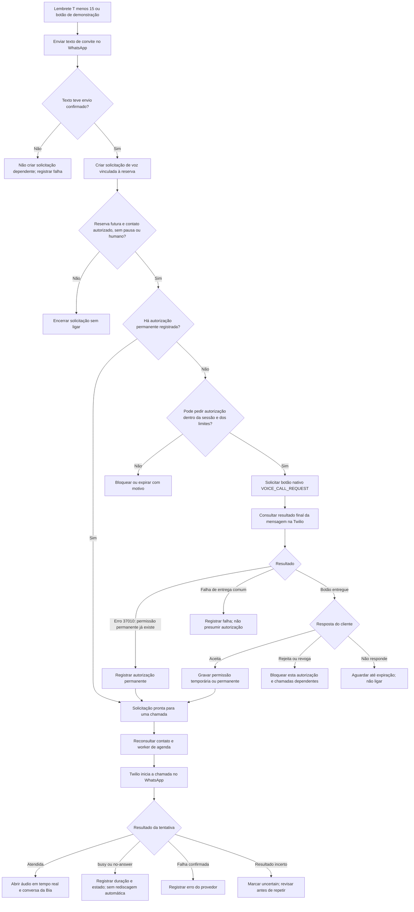

Uma solicitação produz no máximo uma chamada automática. O aceite temporário dura sete dias; a autorização permanente não recebe essa expiração local, mas pode ser revogada. Os pedidos de permissão têm limite local de uma solicitação em 24h e duas em sete dias quando um novo pedido é necessário.

Receber `37010` não significa que o botão ainda precisa chegar: o provedor informou que a autorização permanente já existe. A aplicação então segue com a solicitação atual. Pedido entregue, sozinho, não equivale a autorização.

Enquanto há chamada ativa ou uma operação de voz incerta, respostas e efeitos de outros canais podem aguardar para evitar duas abordagens simultâneas. As mensagens recebidas continuam sendo armazenadas. Pedidos explícitos de saída têm caminho prioritário no motor, e a sessão relê as condições para interromper o atendimento.

## 9. Dentro da chamada — prompt e ferramentas próprios

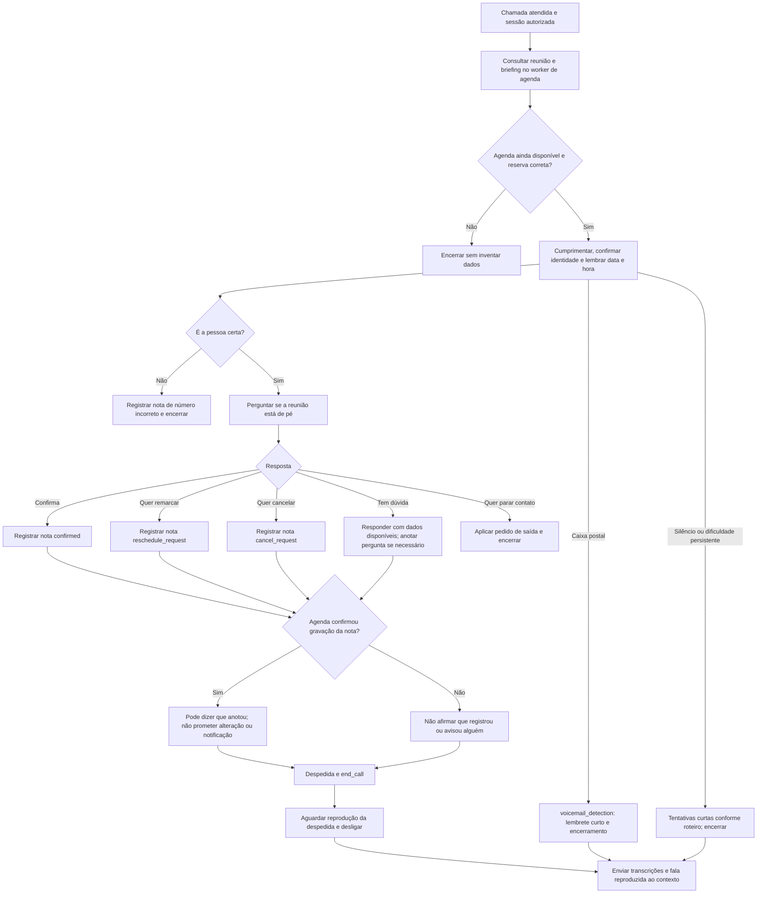

Ferramentas atuais: `get_meeting`, `record_reminder_note`, `end_call` e `voicemail_detection`. As notas aceitam confirmação, pedido de remarcação, pedido de cancelamento, pergunta e número incorreto.

**Pedido anotado na ligação não modifica a reserva nem aciona automaticamente uma conversa de texto.** A equipe consulta a nota, ou o cliente continua pelo WhatsApp para uma alteração executável. Uma confirmação verbal gravada em nota também não é o evento de comparecimento real.

O áudio passa por Twilio Media Streams e OpenAI Realtime, com interrupção da fala quando o cliente fala. O contexto recebe a fala da Bia depois da confirmação de reprodução; uma fala interrompida não é registrada como integralmente ouvida. O limite da sessão é de cinco minutos. Dados vazios de consultor, formato, sala ou briefing continuam desconhecidos.

## 10. Silêncio, pausa, saída, humano e resultado da reunião

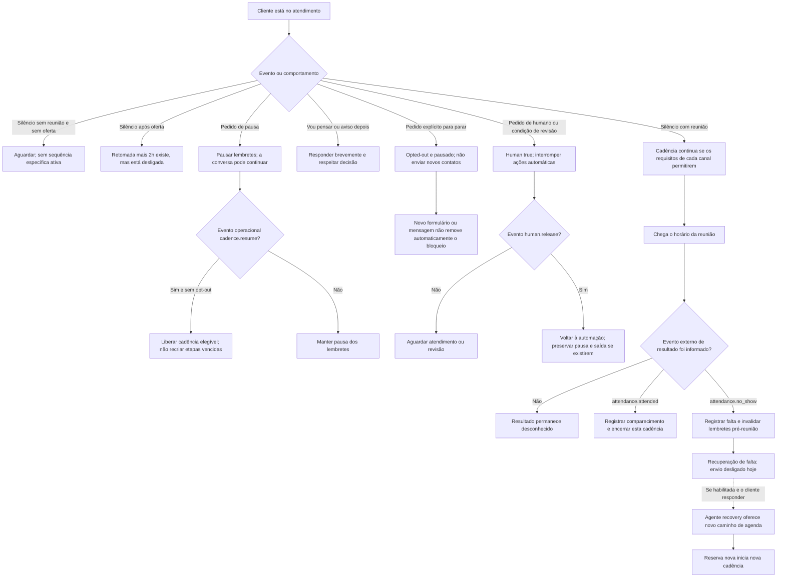

Não há detecção automática de entrada na sala, reunião realizada, venda ou falta. Passar do horário, não atender uma chamada ou não responder WhatsApp não cria `attendance.no_show`. Os resultados devem chegar por integração ou ação operacional.

O fluxo atual também não contém uma cadência comercial de pós-reunião, proposta, fechamento ou pós-venda. Esses são possíveis próximos ciclos, não caminhos já ativos.

## 11. Antes de qualquer ação — bloqueios, concorrência e falhas

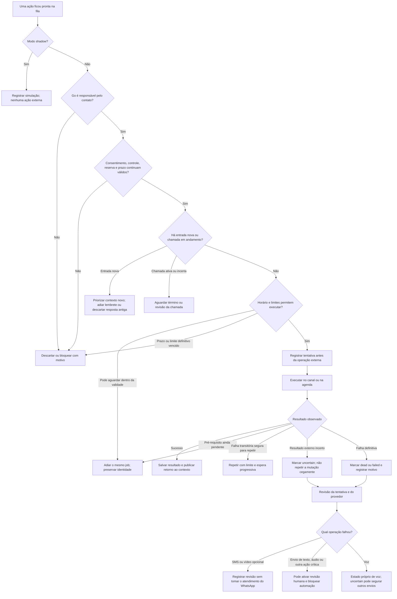

Antes de criar um job, os endpoints também podem devolver rejeições: pedido inválido, conflito de idempotência, submissão expirada, contato bloqueado, reserva ausente, sessão de WhatsApp ausente, consentimento de SMS ausente, voz em andamento e limites de demonstração. **HTTP 202 significa que a ação entrou na fila; não significa entrega.**

Os estados `sent` e `delivered` também são diferentes. Os consumidores podem concluir um envio quando o provedor informa `sent`. O resultado final pode exigir consulta à Twilio; não há hoje reconciliação completa e contínua de todos os envios antigos. A auditoria recente confirmou entregas consultando o provedor diretamente.

As rejeições HTTP anteriores ao job ainda não possuem uma trilha persistente por tentativa. Isso é uma lacuna de observabilidade, não um caminho de cliente resolvido por um prompt.

## 12. Botões da demonstração — antecipar sem esperar a reunião

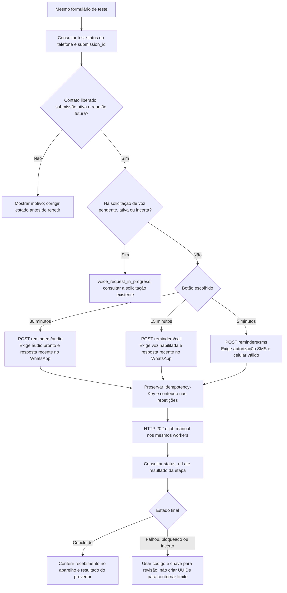

Esses botões antecipam o envio atual. Eles não mudam data/hora, não consomem automaticamente a etapa futura da cadência e não desativam a etapa automática equivalente. Portanto, um áudio manual agora e o T−30 futuro podem produzir dois envios intencionais.

Validade da demonstração: até 10 minutos, limitada ao início da reunião. Há intervalo mínimo por tipo de disparo, limite global e limites próprios da autorização de chamada. O botão não ignora consentimento, reserva, controle humano, sessão de WhatsApp ou autorização de voz.

Base dos endpoints: `/webhooks/test-form/:key`.

| Endpoint | Função |
|---|---|
| `POST /` | Cadastrar formulário e iniciar contato; aceita `slot_id` opcional |
| `GET /availability` | Consultar vagas livres |
| `POST /bookings` | Reservar pelo formulário já ativado |
| `POST /test-status` | Consultar reserva, consentimentos e pré-requisitos do contato |
| `POST /sms-consent` | Registrar ou retirar a preferência SMS; aplicação é assíncrona |
| `POST /reminders/audio` | Antecipar áudio |
| `POST /reminders/call` | Antecipar convite e fluxo de chamada |
| `POST /reminders/sms` | Antecipar SMS |
| `GET /reminders/:action/:id` | Consultar as etapas da solicitação manual |

## 13. Visão técnica — os seis workers e a comunicação

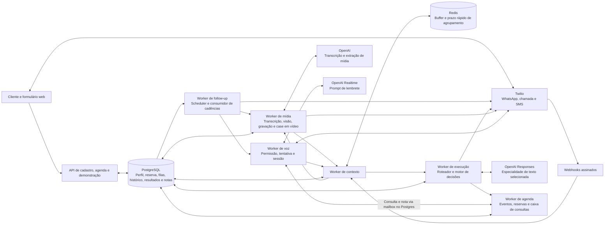

As setas entre workers representam trabalho e resultados persistidos, não necessariamente uma chamada HTTP direta. As filas e caixas de entrada são do Postgres (`jobs`, `worker_tasks`, `agenda_requests`, `voice_requests`). Redis acelera a janela, mas não é a única cópia das mensagens.

A reserva pelo formulário é uma exceção importante à frase “só o worker de agenda grava reservas”: **a API também pode reservar em transação**, reutilizando as regras da agenda local e publicando o evento que o worker de agenda processa. Já as decisões de agenda geradas na conversa são executadas pelo worker de agenda.

Todo o controle comercial e a orquestração estão no nosso código Go. Twilio transporta mensagens/chamadas, OpenAI executa inferência e Postgres/Redis mantêm estado. O n8n não é uma etapa desse caminho.

### Estados principais para enxergar o cliente

| Dimensão | Estados ou informações que influenciam o caminho |
|---|---|
| Identidade e controle | Telefone, responsável `go`, consentimento, `paused`, `opted_out`, `human` |
| Perfil compartilhado | Pessoa, empresa, receita, objetivo e fuso |
| Reserva | Sem reserva, agendada, em andamento pelo intervalo, remarcada, cancelada, resultado desconhecido, compareceu ou faltou |
| Oferta | Sem oferta, duas opções atuais, escolha pendente, agenda vazia ou consulta indisponível |
| Contexto | Fragmentos chegando, mídia pendente, Run congelada, resposta em partes ou entrada nova |
| Memória | Histórico compartilhado, objeção/motivo, argumentos enviados, condição pendente e `previous_response_id` por especialista/versão |
| Canal | Sessão de WhatsApp, consentimento e telefone SMS, permissão de chamada temporária/permanente |
| Operação | Pendente, executando, adiada, concluída, pulada, falhou ou incerta |

## 14. Ciclo proposto para evoluir prompts e agentes

**Este diagrama é uma proposta de trabalho, não uma automação já implantada.** O ciclo atual de atendimento está nas seções anteriores. Aqui está o ciclo para melhorá-lo com evidência e sem deixar o agente publicar sozinho suas próprias regras.

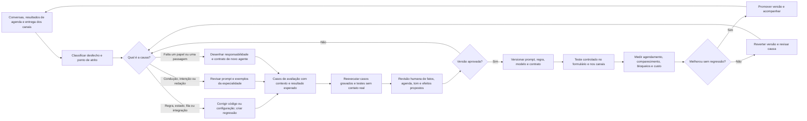

### Fronteiras sugeridas para discutir novos agentes

| Responsabilidade | Como está hoje | Próxima evolução para avaliar |
|---|---|---|
| Agendamento inicial | `persuasion` e `scheduling`, com prompts próprios e Decisions | Avaliar conversas e comparar agendamento real |
| Comparecimento | Especialista `attendance`; cadência determinística | Medir presença e qualidade das respostas de preparação |
| Objeções | Especialista próprio, memória de motivos e argumentos enviados | Ampliar biblioteca com casos reais e medir resolução reconhecida pelo cliente |
| Retomada sem resposta | Uma retomada de oferta existe, mas está desligada; não cobre toda abertura | Projetar uma cadência finita, com saída explícita, intervalo e critérios por estágio |
| Reagendamento pedido na voz | Apenas nota para consulta | Passagem durável para texto/agenda e confirmação do cliente antes de alterar a reserva |
| Falta à reunião | Evento externo e especialidade `recovery` | Integrar presença real e definir uma sequência curta de recuperação |
| Depois da reunião | Não há cadência comercial própria | Definir proposta, decisão, fechamento e pós-venda somente após existir resultado confiável |
| Qualidade e supervisão | Testes, logs e consultas manuais | Avaliador de conversas que proponha melhorias para revisão, sem alterar produção sozinho |

### Perguntas que o mapa permite decidir

1. Qual é o próximo passo para quem preencheu, não agendou e nunca respondeu à abertura?
2. Como oferecer uma saída clara a quem está pensando, sem transformá-la em pausa permanente indevida?
3. Preparação noturna deve ser pulada, remarcada para a manhã ou não ser programada nesse horário?
4. Quem pediu remarcação na voz deve receber uma conversa de texto automaticamente? Qual confirmação é necessária?
5. O que fazer após `busy` ou `no-answer`: nenhuma nova tentativa, uma retomada por texto ou uma tentativa em outro momento?
6. Qual integração será a fonte confiável de comparecimento e no-show?
7. Antes de ligar a recuperação, qual texto substituirá a referência à URL de agendamento que hoje está vazia?
8. O que muda na cadência para alguém que confirmou presença, demonstrou dúvida ou pediu ajuda para entrar?
9. Quem recebe e assume o atendimento quando `human=true`? Hoje há estado e nota local; não existe notificação automática de equipe implementada por esse caminho.
10. Qual identificador e trilha de requisições permitem descobrir um erro de formulário sem depender de uma captura de tela?

## 15. Limites atuais que não devem desaparecer no desenho

- Não há ciclo automático de autoedição de prompts nem conversa livre entre agentes. Roteamento e validação são do código.
- O estado de atendimento humano exige liberação operacional. Uma nova saudação ou um novo formulário não fazem essa liberação.
- Pedidos de pausa precisam de `cadence.resume` para reabrir a cadência. Voltar a conversar, sozinho, não corresponde a esse evento.
- Ausência de vagas gera pendência; não há notificação automática implementada para quando uma vaga nova surgir.
- A chamada registra notas e não executa alteração de reserva. Essas notas não notificam automaticamente o consultor nem iniciam um agente de texto.
- Não há rediscagem automática nem detector automático de falta. `busy`, `no-answer`, silêncio e mensagem não lida não comprovam no-show.
- O envio de recuperação de falta está desligado e seu texto atual usa a URL de agendamento. Como essa URL está vazia neste ambiente, ele precisa ser revisado antes de habilitar esse caminho.
- A antecedência mínima é 30 minutos, mas o mapa não promete que rede, fila e operadora entreguem exatamente no segundo programado.
- A cadência manual e a automática são independentes. É possível receber ambas no mesmo teste.
- Dizer que não foram encontradas novas falhas na auditoria não equivale a homologar todos os caminhos deste documento.

## 16. Referências do código e da configuração

| Parte do mapa | Fonte principal no repositório |
|---|---|
| Entrada, cadastro e primeira abertura | `internal/httpapi/test_form.go`, `internal/store/form_contact.go`, `internal/domain/form_contact.go` |
| Reserva pelo formulário | `internal/httpapi/test_calendar.go`, `internal/store/form_booking.go` |
| Entrada WhatsApp e permissão | `internal/voiceworker/messages.go`, `internal/voiceworker/http.go` |
| Contexto, agrupamento e memória | `internal/store/context.go`, `internal/contextworker/worker.go`, `internal/contextworker/buffer.go` |
| Extração de mídia | `internal/providers/media.go`, `internal/providers/audio.go`, `internal/mediaworker/worker.go` |
| Vídeo após a abertura | `internal/domain/intro_video.go`, `internal/providers/video.go`, `internal/casemedia/asset.go` |
| Decisions, especialistas e prompts de texto | `internal/agent/decisions.go`, `internal/agent/specialists.go`, `internal/agent/prompts/`, `internal/agent/openai.go` |
| Memória comercial e revisão | `internal/domain/dialogue.go`, `internal/agent/quality.go` |
| Decisões, controle e validações | `internal/domain/engine.go`, `internal/worker/worker.go` |
| Operações e consulta da agenda | `internal/schedulingworker/worker.go`, `internal/schedulingworker/agenda.go`, `internal/providers/local.go` |
| Cadência e reconciliação | `internal/domain/reminders.go`, `internal/domain/sms.go`, `internal/store/reminders.go`, `internal/followupworker/worker.go` |
| Voz, permissão e ferramentas | `internal/voiceworker/worker.go`, `internal/voiceworker/store.go`, `internal/voiceworker/tools.go` |
| Roteiro e áudio da chamada | `internal/voiceworker/reminder_prompt.txt`, `internal/voiceworker/prompt.go`, `internal/voiceworker/bridge.go` |
| Botões e pré-requisitos | `internal/httpapi/test_reminders.go`, `internal/store/test_reminders.go`, `internal/httpapi/test_contact.go` |
| Resposta em partes | `internal/domain/reply_parts.go`, `internal/worker/reply_typing.go` |
| Parâmetros | `internal/config/config.go`, `internal/config/voice.go`; valores não secretos conferidos no servidor |

Valores observados: `live`, contato automático e vídeo de abertura ligados, retomadas gerais desligadas, preparação/reunião/SMS/voz ligados, sem restrição a um único telefone de teste, sem URL de sala, sem URL de agendamento e sem pedido de permissão de voz fora da sessão. Os limites atuais de homologação são 100 envios por contato/dia e 300 globais/hora; não são uma recomendação de cadência comercial.
