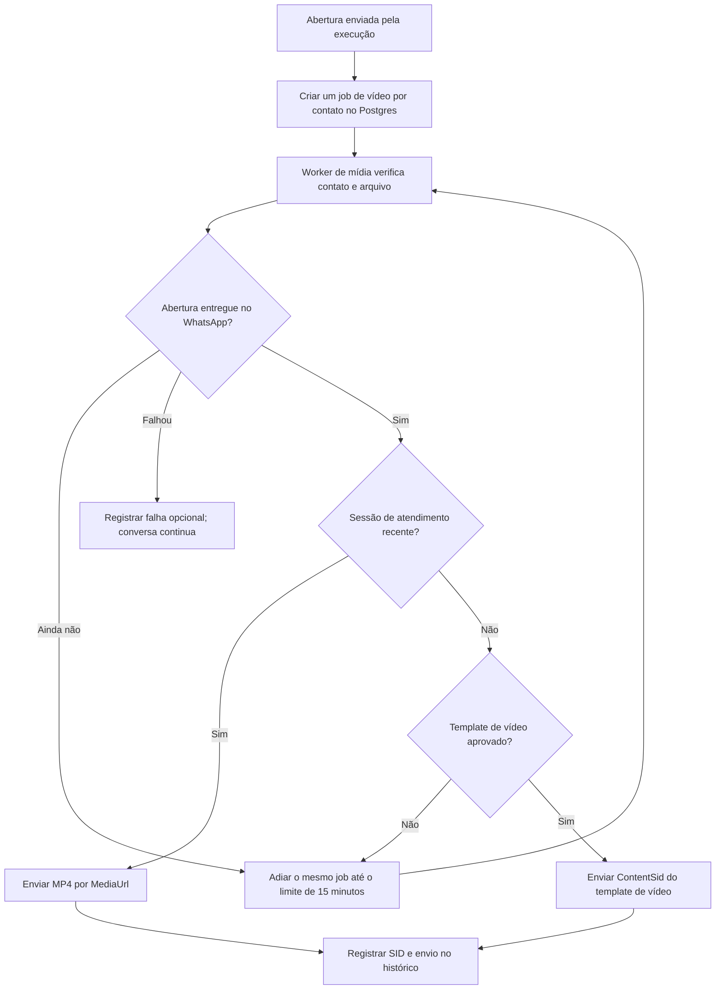

# Vídeo case Camozzi após a abertura

Publicado na homologação em 29/10/2026, release `r-584cc31d2fe4`, migração 15. O template `arkom_case_camozzi_v1` foi aprovado e o envio foi habilitado para novas aberturas. A entrega em aparelho deste novo vídeo ainda depende de um novo teste do formulário.

O formulário mantém a abertura existente: confirma a reserva atual quando há reunião e convida a agendar quando ainda não há. Depois da entrega dessa mensagem, o worker de mídia envia `case camozzi.mp4`, fornecido pela equipe, como vídeo nativo no WhatsApp.



- A primeira tentativa fica elegível dois segundos após o envio da abertura. A entrega efetiva depende da confirmação `delivered` ou `read` da abertura e do processamento da fila.
- A chave `fx/intro-video:<lead_id>` impede um segundo case para o mesmo contato, inclusive após reinício ou novo formulário. A limpeza completa do contato para um novo teste também precisa remover esse job, assim como os demais dados.
- Não há envio retroativo para aberturas antigas. O job nasce após sucesso de uma nova abertura `form_contact` ou `welcome`.
- Não exige reserva nem confirmação de presença. Exige consentimento de contato, automação liberada e arquivo íntegro.
- Respostas novas em processamento adiam o vídeo; não apagam a solicitação. Pausa, opt-out e atendimento humano impedem o envio.
- O prazo é de 15 minutos após a abertura. Uma falha no vídeo registra revisão sem tomar o atendimento de texto para um humano. Um POST de resultado incerto não é repetido automaticamente.
- O vídeo é uma ação de código, não uma ferramenta que o modelo pode disparar repetidamente. A transcrição/visão de anexos recebidos continua no mesmo worker de mídia.

A preparação em T0 + 15 minutos e os lembretes T−30/T−15/T−5 continuam com seus próprios relógios. O vídeo não substitui essas etapas.

## Arquivo e envio

O arquivo instalado tem 7.210.003 bytes, aproximadamente 59 segundos, resolução 576 × 1024 e codecs H.264/AAC. A decodificação foi conferida sem alterar o original. SHA-256:

```text
4b20f519bca440bca910b89289783612b3e56bf37ffef9954f7d33ed1e7cc009
```

O servidor entrega somente o MP4 configurado, em `/media/cases/<sha256>.mp4`, com suporte a GET, HEAD e Range. Valida hash, tamanho e cabeçalho antes de servir; o arquivo fica em volume somente leitura. Credenciais e arquivos de mídia ficam fora do Git.

Fora da janela conservadora de 23 horas desde a última entrada, o envio usa o template `arkom_case_camozzi_v1`, categoria MARKETING, com corpo:

> Enquanto isso, conheça o case Camozzi neste vídeo.

Dentro da janela, envia o vídeo sem legenda; a mensagem inicial já aparece acima dele. O conteúdo aprovado está em `deploy/intro-video-template.json`. O envio com `ContentSid` não mistura `Body` nem `MediaUrl` no mesmo pedido.

Referências: [mídia em templates Twilio](https://www.twilio.com/docs/content/twilio-media) e [formatos de mídia para WhatsApp](https://www.twilio.com/docs/whatsapp/guidance-whatsapp-media-messages).

## Instalação e configuração

1. Conferir os codecs e executar `sudo python3 install-intro-video.py /caminho/case.mp4` no servidor. O instalador configura o hash/diretório e deixa o vídeo desabilitado.
2. Publicar a API, o worker de mídia e a migração 15; incluir a rota de mídia no Caddy e o volume nos containers.
3. Conferir a URL pública e cadastrar/aprovar o template de vídeo na Twilio antes de ativar.
4. Executar `sudo python3 enable-intro-video.py HX...`; o script verifica aprovação e correspondência da mídia antes de atualizar o ambiente de execução:

```dotenv
BIA_INTRO_VIDEO_ENABLED=true
BIA_INTRO_VIDEO_DIR=/media/cases
BIA_INTRO_VIDEO_SHA256=4b20f519bca440bca910b89289783612b3e56bf37ffef9954f7d33ed1e7cc009
TWILIO_INTRO_VIDEO_CONTENT_SID=HX...
```

`BIA_VOICE_PUBLIC_URL` fornece a origem HTTPS comum dos webhooks e da mídia. Recriar os serviços após mudar o ambiente. Para desligar novos envios, definir `BIA_INTRO_VIDEO_ENABLED=false` e recriar execução/mídia.

## Verificação

Os testes de integração com Postgres isolado e Twilio simulada cobrem ordem de entrega, espera por aprovação, sessão aberta, repetição do formulário, opt-out, pausa, humano e resultado externo incerto. Os testes HTTP cobrem MIME, Range, HEAD, caminho inválido e alteração do arquivo. Nenhum desses testes envia mensagens a pessoas reais; a validação no aparelho depende de uma nova submissão autorizada.
