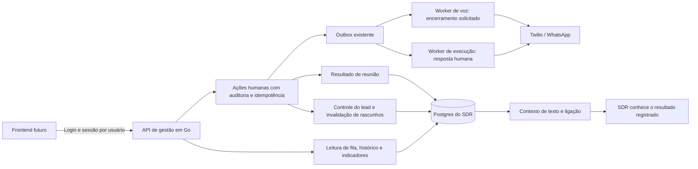

# Backend de gestão do SDR

A API da equipe é escrita em Go, usa o Postgres atual e consulta os mesmos registros dos workers. Não há frontend neste pacote. O contrato OpenAPI 3 está em `internal/management/openapi.json`; o mesmo arquivo é servido por `GET /v1/management/openapi.json` após login. Ele pode ser importado no Postman ou usado para gerar o cliente do futuro painel.

## O que o frontend pode construir

- Fila pesquisável por pessoa, empresa, telefone ou e-mail, com filtros de etapa, responsável, temperatura, controle de automação e situação comercial.
- Contadores de atendimentos abertos, atendimento humano, pausa, leads quentes e casos que exigem atenção; distribuição por etapa.
- Ficha com dados do formulário, reserva atual, horários oferecidos, memória comercial e resultados anteriores de reunião.
- Histórico de mensagens de WhatsApp, SMS e falas de voz, incluindo caixa de saída pendente ou falha, com identificação de IA, cliente e operador. Uma mensagem pendente não aparece como entregue.
- Mídias recebidas por download autenticado e mídias públicas enviadas pelo SDR. As descrições e transcrições da mídia continuam disponíveis mesmo quando o provedor não disponibiliza mais o arquivo original.
- Lista de ligações, permissão, estado, interrupção e transcrição por interlocutor. Não há gravação de áudio de ligação neste sistema; as falas da assistente são as que tiveram reprodução reconhecida pelo fluxo existente.
- Follow-ups por pessoa, com finalidade, tentativas, datas, resultado, modo real/simulado e distinção de demonstração manual.
- Operações humanas: assumir, pausar, devolver à IA, atribuir responsável, anotar, responder no WhatsApp, encerrar, ganhar/perder venda e registrar ou corrigir comparecimento.
- Indicadores por período e série diária, com unidades e denominadores explícitos.

## Autenticação e papéis

`BIA_MANAGEMENT_ENABLED=true` monta somente a API de gestão. `BIA_MANAGEMENT_ORIGINS` aceita origens exatas do frontend; `http://localhost:porta` é permitido em desenvolvimento. A URL pública configurada também é permitida. Não há CORS curinga. Um BFF sem cabeçalho Origin pode chamar a API normalmente.

Usuários usam nome de login e senha, com três papéis: `viewer` consulta, `operator` consulta e atende leads, `admin` também administra usuários. A senha tem entre 12 e 256 bytes e é armazenada com PBKDF2-HMAC-SHA256, 600.000 iterações e salt aleatório. O login emite uma sessão aleatória de 12 horas; só o hash do token é armazenado. Logout, desativação, troca de senha ou de papel revogam sessões. O último administrador habilitado não pode ser removido. O login tem limite de dez tentativas por nome em quinze minutos e teto de 120 por endereço da conexão, inclusive quando compartilhado por proxy. A API não confia em cabeçalhos de IP enviados pelo cliente.

O token interno `BIA_API_TOKEN` não autentica no painel e não deve ser fornecido ao frontend. Para criar o primeiro usuário, use o binário no servidor, com a senha na entrada padrão:

```sh
read -s 'MANAGEMENT_PASSWORD?Senha inicial: '
printf '\n'
printf '%s\n' "$MANAGEMENT_PASSWORD" | sudo docker compose exec -T api /bia -management-create-user admin -management-user-role admin
unset MANAGEMENT_PASSWORD
```

O exemplo usa zsh e deve ser executado no diretório de publicação por quem já possui acesso administrativo ao servidor. O comando cria a identidade e sai; não inicia outros workers. Os usuários seguintes podem ser criados pela API. As credenciais iniciais da publicação assistida ficam somente no arquivo local indicado na entrega, com permissão `0600`.

## Endpoints

Todos os caminhos abaixo usam o prefixo `/v1/management`.

| Método e caminho | Uso |
|---|---|
| `POST /auth/login` | `{ "username": "admin", "password": "..." }` → `access_token`, `expires_at`, usuário |
| `GET /auth/me` | Usuário da sessão |
| `POST /auth/logout` | Revogar sessão atual |
| `GET /users` | Usuários disponíveis para atribuição |
| `POST /users` | Administrador cria usuário |
| `PATCH /users/{user}` | Administrador altera papel, senha ou habilitação |
| `GET /leads` | Fila com score, etapa, reserva, responsável e contadores |
| `GET /leads/{id}` | Ficha e contexto do lead |
| `GET /leads/{id}/messages` | Histórico unificado e caixa de saída |
| `GET /leads/{id}/calls` | Ligações e estado do pedido de interrupção |
| `GET /leads/{id}/calls/{call}/transcript` | Transcrição em ordem cronológica |
| `GET /leads/{id}/followups` | Registro operacional de follow-ups |
| `GET /leads/{id}/bookings` | Histórico de reservas e comparecimento |
| `GET /leads/{id}/actions` | Notas e auditoria da equipe |
| `POST /leads/{id}/actions` | Comando de atendimento com idempotência |
| `GET /leads/{id}/media/{asset}` | Arquivo recebido, sem expor credenciais Twilio |
| `GET /metrics` | Indicadores e séries |
| `GET /openapi.json` | Contrato tipado para o frontend |

Depois do login, enviar `Authorization: Bearer <access_token>`. Listagens usam `limit` de 1 a 100 e cursor retornado pela própria resposta. Leads são ordenados por atualização; mensagens, ligações e reservas por data decrescente. Follow-ups e auditoria usam `before_seq`; a transcrição usa `after_seq` crescente. IDs de ligação podem conter barras: codificar o ID como um segmento de URL. O frontend pode atualizar a ficha e os indicadores por consulta periódica; esta versão não oferece SSE/WebSocket para o painel.

Filtros de `/leads`: `q`, `stage`, `temperature=hot|warm|cold`, `automation=active|human|paused|opted_out|no_consent`, `status=open|closed|won|lost`, `assigned_to`. Etapas: `contact_pending`, `contacted`, `engaged`, `scheduling`, `booked`, `presence_confirmed`, `in_meeting`, `awaiting_attendance`, `attended`, `no_show`, `cancelled`. A etapa comercial e o controle da IA são campos separados: um lead pode estar agendado e, ao mesmo tempo, sob atendimento humano.

## Comandos da equipe

`POST /leads/{id}/actions` exige `Idempotency-Key`. Repetir a mesma intenção com a mesma chave e usuário devolve a operação anterior. Reutilizar essa chave com outro corpo ou lead retorna `409 idempotency_conflict`. `expected_revision` é opcional e evita escrever sobre uma ficha que mudou; nesse caso, atualizar a ficha após `409 revision_conflict`.

```json
{ "kind": "takeover", "reason": "Vou continuar o atendimento", "expected_revision": 12 }
```

| `kind` | Campos e efeito |
|---|---|
| `takeover` | Ativa controle humano e permite resposta manual; mantém opt-out protegido |
| `pause` | Pausa automação e ativa controle humano; mensagens continuam sendo registradas |
| `release` / `resume` | Retorna à IA se o lead estiver aberto, autorizado e sem opt-out |
| `assign` | `assigned_to`: ID do usuário habilitado; vazio desatribui |
| `note` | `text`: anotação interna; não é enviada ao cliente nem inserida no prompt |
| `message` | `text`: até 1.000 caracteres, envio manual pelo transporte e ledger existentes |
| `status` | `status`: `open`, `closed`, `won` ou `lost`; `reason` obrigatório para encerrar ou perder |
| `attendance` | `booking_id`, `outcome`: `attended` ou `no_show`; `reason` permite explicar correção |

Assumir ou pausar invalida rascunhos ainda em processamento e bloqueia a resposta automática que estava na fila. Mensagens novas continuam entrando no Postgres. Ao devolver o lead à IA, o corte usa o recebimento no servidor, preservando o histórico e evitando reativar mensagens antigas. Isso também evita descartar mensagens novas quando a Twilio informa o horário com precisão de segundos.

Um efeito externo já iniciado não pode ser recolhido: nesse caso, a API retorna `409 contact_busy`, com `retryable=true`, e não informa falsamente que assumiu o atendimento. Repetir a mesma intenção e chave depois do efeito. Ações confirmadas têm ator, corpo, resultado, data e revisão na auditoria.

Tomar controle revoga ligações pendentes. Se a chamada já está chamando ou conectada, o worker de voz recebe uma solicitação durável de encerramento. `stop_state` mostra `pending`, `running`, `done` ou `uncertain`; o painel não deve mostrar “encerrada” enquanto o pedido está pendente. Uma resposta perdida do provedor permanece incerta, sem repetição automática da mutação. O motivo `operator_interrupted` indica controle humano esperado; `operator_stop_uncertain` exige conferência. A ponte conectada também verifica a autorização a cada segundo. Um rascunho de ligação cujo POST ainda terminava depois da tomada de controle também gera o encerramento quando recebe o Call SID.

Resposta manual exige controle humano, autorização de WhatsApp, ausência de pausa/opt-out e janela de atendimento aberta. Não contorna regras da Meta nem envia template arbitrário fora da janela. O retorno contém `job_id` e `delivery_status=queued`; consultar o histórico para verificar o resultado. Reabrir uma ficha encerrada não devolve automaticamente a IA. Marcar `won`, `lost` ou `closed` suspende a automação; `first_won_at` registra somente a primeira venda, evitando duplicar conversões em reaberturas.

## Comparecimento e memória da IA

`attended` pode ser informado a partir do início da reunião. `no_show` só é aceito após o fim previsto. Reservas canceladas não recebem resultado por esse endpoint. Uma correção substitui o resultado da mesma reserva, preservando os comandos anteriores na auditoria.

O resultado atualiza o registro da reunião, o estado do lead e uma memória limitada aos dez últimos resultados registrados. A IA de texto e a IA de ligação recebem esses fatos no contexto. Registrar resultado de uma reserva anterior não troca nem cancela a reserva atual. Para a reserva atual, `no_show` usa a recuperação existente; `attended` invalida uma recuperação pendente. Entrega de mensagem, confirmação de intenção e passagem do horário não registram presença ou falta automaticamente.

## Temperatura matemática

`engagement-v1` é uma pontuação de engajamento de 0 a 100. Não representa probabilidade de venda e ainda não foi calibrada por resultados comerciais. A API retorna cada sinal e seus pontos; uma única definição em Go gera o cálculo SQL usado nos filtros e a explicação.

| Evidência observável | Pontos |
|---|---:|
| Nome e telefone | +5 |
| Objetivo informado | +5 |
| Pelo menos uma resposta recebida | +20 |
| Resposta nas últimas 24 horas | +15 |
| Resposta entre 1 e 7 dias, em vez do bônus de 24h | +8 |
| Três ou mais mensagens recebidas, incluindo falas de voz persistidas | +10 |
| Reunião futura ou em andamento | +25 |
| Confirmação de presença da reserva atual ainda válida | +15 |
| Último resultado registrado: compareceu | +20 |
| Objeção em aberto ou esclarecimento | −10 |
| Último resultado registrado: faltou | −20 |

A soma é limitada a 0–100. Opt-out zera o score e bloqueia automação. A pausa ou intervenção humana não é tratada como desinteresse do cliente. Frio: 0–39; morno: 40–69; quente: 70–100. Faturamento, quantidade de follow-ups enviados e opinião livre do modelo não somam pontos. Recência usa o horário consultado, por isso a temperatura pode cair sem nova mensagem.

## Métricas e definições

`GET /metrics?from=<RFC3339>&to=<RFC3339>&timezone=America/Cuiaba` aceita intervalo positivo de até 366 dias; o padrão é de 30 dias até agora. `from` é inclusivo e `to` exclusivo. O fuso organiza a série por dia; os timestamps continuam em RFC3339. As consultas de uma resposta usam o mesmo snapshot de leitura do Postgres.

- `snapshot`: fotografia atual de todos os leads. Aberto significa situação `open` e ausência de opt-out; inclui atendimento humano e pausa. Não significa que a IA está executando naquele instante. Os contadores de humano e pausa podem se sobrepor.
- `lead_cohort`: pessoas criadas no intervalo. Conversão para agendamento é a proporção com pelo menos uma reserva criada, mesmo que depois cancelada. Conversão para venda exige marcação explícita de `won`. Os tempos são do cadastro até o primeiro agendamento, primeira venda e primeira mensagem de saída aceita pelo transporte (WhatsApp, SMS ou mídia; não mede o primeiro telefonema). Só durações não negativas entram na amostra. Médias/medianas sem amostra são `null`.
- `meeting_cohort`: reservas cujo início está no intervalo. `show_up_rate = attended / (attended + no_show)`, excluindo canceladas e resultados desconhecidos. Sem resultado conhecido, retorna `null`. `completed_without_outcome` mostra reuniões terminadas que precisam de registro. A cobertura informa a fração de reuniões terminadas com resultado preenchido.
- `followups`: envios reais confirmados pelo transporte, separados de testes manuais. Não conta efeitos simulados, pulados, pais de respostas picadas ou mera criação de job como contato enviado. Aceitação do provedor não comprova leitura pelo cliente. A tabela individual continua expondo pendências, tentativas, falhas e incertezas.
- `daily_events`: eventos por dia — novos leads, reservas criadas e primeiras vendas registradas. Remarcações podem gerar novas reservas; essa série não deve ser usada como contagem de pessoas únicas convertidas.

As taxas são frações de 0 a 1, acompanhadas de amostra. Tempo para agendamento e tempo para venda são indicadores diferentes. Não há valor monetário de venda nem atribuição de receita nesta versão. A fonte é o banco atual; registros reais e simulações ficam identificados no histórico operacional, e envios simulados não entram no contador de follow-ups enviados.

## Arquitetura



A configuração existente de WhatsApp, mídia, botões, prompts e follow-ups continua usando os mesmos workers. Os usuários administrativos não são cadastros de clientes; os resets de testes preservam usuários e sessões e limpam os dados de atendimento e ações ligadas aos leads.

## Publicação e validação

Publicado em 29/10/2026, release `r-55b44bb2ee82`, schema 17. O contrato cobre 16 caminhos, 18 operações e 29 schemas. A suíte completa com PostgreSQL isolado e `-race` passou; a verificação focal de gestão passou após a checagem de consistência dos contadores de abertos. `go vet ./...` e as referências internas do OpenAPI passaram.

A validação pública confere TLS, recusa sem sessão, CORS, login, listagem, métricas, contrato, logout e revogação. A validação operacional confere os sete serviços na mesma imagem, prontidão da API/voz e preservação da configuração dos botões. Evidência local, sem tokens: `.local/deploy/management-live-verification.json`. Os testes de respostas humanas, interrupção de chamada e comparecimento usaram transportes simulados e o banco de testes; não enviaram mensagens para clientes.

Duas tentativas do verificador com `urllib` tiveram timeout pela rede pública. A conferência final com `curl`, mantendo validação TLS, completou todas as rotas, incluindo o contrato completo. A API local respondeu em cerca de 1,5 ms na checagem de prontidão e os sete processos estavam sem reinícios. Nenhuma alteração de dados de clientes foi feita nessa conferência.
