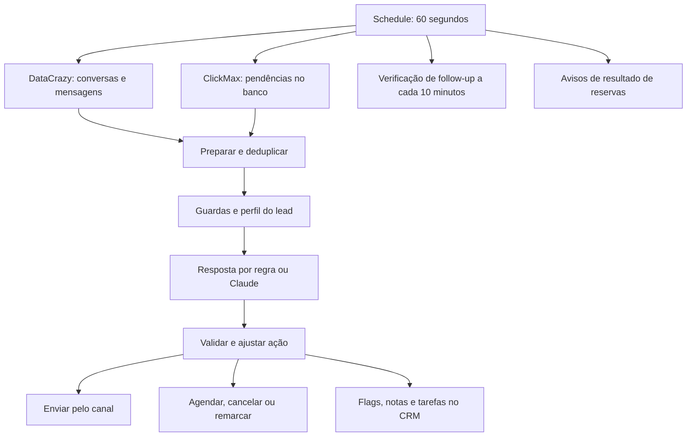

# Análise do fluxo original — 27/10/2026

Fonte: `[ARKOM] Bia SDR IA — WhatsApp Comercial.json`, em Downloads. Análise estática do JSON e uma reprodução isolada com dados sintéticos. Nenhuma edição ou execução em produção. O campo `active: true` descreve o momento da exportação, não comprova o estado atual do servidor.

## Como o fluxo funciona

O único gatilho encontrado é um Schedule de 60 segundos. Ele inicia quatro caminhos:

Não há nó de entrada do formulário neste export. `Preparar` exige mensagem recebida nova, deixa de responder se a última mensagem foi enviada pelo próprio canal e espera 30 segundos sem nova mensagem. Considerando apenas esse debounce e um polling regular de 60 segundos, uma mensagem pode aguardar aproximadamente 30–90 segundos antes da preparação, além do tempo de fila, rede e modelo. Isso não é um SLA medido.

O ramo de follow-up exige oferta anterior e condições específicas; o ramo de avisos depende de resultados de reserva armazenados. Nenhum deles constitui uma rotina geral de primeiro contato de todo cadastro novo.

## Achados prioritários

### 1. Este fluxo não garante contato inicial após cadastro

**Evidência:** gatilho Schedule; consultas `DC: Conversas`, `DC: Mensagens`, `CM: Pendentes`; filtros `ultima_palavra_nossa`, `sem_inbound_novo`, `debounce_30s` no nó `Preparar`. O prompt também restringe a fala ao momento em que o lead escreve.

**Consequência:** preencher o formulário pode não criar uma entrada processável por esta Bia. Pode haver outro componente responsável pela primeira mensagem. Sem seu código e logs, não é possível determinar se esse componente existe ou falhou.

**Relação com o relato:** explica por que a existência deste fluxo ativo não basta para garantir que o usuário receba uma mensagem após cadastrar-se.

### 2. DataCrazy: intenção de responder pode ser registrada como resposta realizada

**Evidência:** em `finalizarBase`, `send` depende de modo live, ausência de erro e texto não vazio. O objeto persistido já inclui `replied: send` e `sent_via: 'mcp'`. `sqlMesclarLog` também grava `handled = true`.

O grafo liga `Explodir bolhas` diretamente a dois destinos: `DC: Send Leo` e `PG: Finalizar`. A gravação no banco não depende de um recibo positivo de `DC: Send Leo`; o nó de envio usa `continueRegularOutput` e `neverError`.

**Risco confirmado na estrutura:** erro ou recusa no envio pode coexistir com `replied=true`. Isso pode afetar inspeção do atendimento, deduplicação e elegibilidade de follow-ups.

**Limite:** não foi demonstrada uma ocorrência real. O ramo de avisos de reserva tem conferência explícita de status e não deve ser confundido com este caminho de resposta comum. A conferência de passos do questionário do site também é um caminho específico.

**Direção de correção:** separar intenção, tentativa, aceite, entrega e falha; concluir o envio a partir do resultado do provedor, com operação idempotente e reconciliação quando o resultado é desconhecido.

### 3. Follow-up da DataCrazy pode ser consumido antes de sair

**Evidência:** `sqlFollowup` preenche o campo `followup` apenas quando ele ainda é nulo. A ordem é `PG: Log follow-up` → `Bia: Follow-up gravado?` → roteamento do canal → `DC: Enviar follow-up`. Este último nó não tem uma continuação no grafo para confirmar o envio ou liberar uma tentativa falha.

A seleção de candidatos exige `(u.j->'followup') IS NULL`.

**Risco:** se a gravação funcionar e o envio falhar, a mesma oferta deixa de ser elegível para nova tentativa desse ramo. A trava evita duplicidade, mas não oferece recuperação da entrega.

**Limite:** o caminho ClickMax possui tratamento de resultado próprio. A conclusão acima se refere ao caminho DataCrazy do export, sem presumir o que um monitor externo pode reparar.

### 4. Perda de conversa no desempate do cursor — reproduzida

**Evidência:** `Parse conversas` ordena por timestamp e limita a 40 conversas. `Cursor` avança 1 ms quando não há trava e o timestamp examinado não supera a marca anterior. A próxima consulta DataCrazy usa `lastMessageGte`; a marca efetiva usa o maior valor entre histórico e cursor explícito.

**Reprodução com os dois nós originais, em VM sem rede/banco:**

| Ciclo | Conversas selecionadas | Distintas examinadas | Cursor final |
|---|---:|---:|---|
| 1 | 40 de 41 com o mesmo timestamp | 40 | 17:00:00.000Z |
| 2 | As mesmas 40, com ordem estável | 40 | 17:00:00.001Z |

A conversa restante tem timestamp `17:00:00.000Z` e já não atende ao filtro da próxima consulta. Pode reaparecer se receber nova atividade, mas aquela entrada ficou para trás.

**Condições necessárias:** mais de 40 candidatas com timestamp empatado, repetição das mesmas primeiras 40 e ausência de trava de erro/debounce. O teste confirma o defeito nessas condições, não sua frequência em produção.

**Direção de correção:** cursor composto por timestamp e identificador estável, paginação que drene integralmente o empate ou inbox persistente por ID de mensagem. O avanço artificial de 1 ms não prova que todos os itens daquele instante foram vistos.

### 5. Pausa comercial pode durar indefinidamente dentro deste fluxo

**Evidência:** `decidirEntrada` trata certas respostas como “vou ver e te aviso” como pausa de cadência quando não há reunião futura. O código comenta a ausência de um campo de expiração. `PG: Retomar quem remarcou` limpa a pausa quando identifica uma nova reserva futura, sem opt-out.

**Consequência possível:** o lead que pediu tempo pode depender de uma nova reserva para sair da pausa, sem uma retomada por prazo neste fluxo. Isso pode representar intenção comercial, mas precisa ser deliberado e mensurável.

## Quem recebe qual atendimento

`modalidadeDoLeadBase` e `linhaModalidade` definem:

| Perfil | Caminho base |
|---|---|
| A/B/C | Reunião individual |
| D | Direcionamento individual; no código atual, sem link de agenda, com encaminhamento interno |
| E | Nutrição; não oferecer reunião e convidar para a comunidade |
| Sem perfil | Não oferecer horários; direcionar ao diagnóstico |

Reservas existentes/recentemente canceladas e configurações ClickMax podem alterar o caminho. A/B/C podem usar agenda ClickMax ou o tratamento de uma reserva ClickMax existente.

**Não foi encontrada aqui a regra que converte faturamento em score A–E do formulário do site.** O relato “sem faturamento → comunidade” é compatível com o perfil E, mas não prova que o cadastro recebeu E. É necessário o score efetivamente persistido para fechar esse diagnóstico.

## Motivos de silêncio identificados

- Canal fora dos números permitidos.
- Lead suspeito, opt-out do lead ou da conversa, ou controle humano.
- Teto de 15 respostas por conversa/24h ou 60 envios globais/h.
- Sem cadastro: teto de 3 respostas; conversas elegíveis do questionário do site usam teto próprio de 12.
- Mensagem duplicada, sem mensagem nova, debounce ou última fala do próprio canal.
- Áudio sem transcrição: encaminhamento interno, sem resposta ao lead.
- Mensagem classificada como autoresposta de outro sistema.
- Confirmação curta: pode atualizar presença sem enviar texto de volta.
- Dependências com erro ou funções do banco que não devolvem candidatos.

Nem todo silêncio é defeito. A análise operacional precisa registrar o motivo concreto por contato e distinguir proteção válida de abandono.

## Follow-up e agenda

O follow-up é avaliado nos minutos múltiplos de dez. Seleciona até 20 candidatos com oferta anterior há pelo menos duas horas, sem avanço da conversa e dentro das demais restrições. O envio acontece entre 8h e 20h, no fuso usado pelo legado (`America/Sao_Paulo`), com janela de 23h desde a entrada e limite de um follow-up por 24h. O caminho de agenda ClickMax por link tem exclusões próprias; não se pode supor que todo link sem clique gera este follow-up.

Na remarcação, preservar o closer é uma regra forte. Falta de horários do closer ou impossibilidade de identificá-lo pode impedir a oferta. Há consultas ao Cal público, serviço de agenda privada e funções de reserva ClickMax. Portanto, o screenshot “sem horários” não identifica sozinho qual componente falhou.

O site mostra 45 minutos. Trechos do prompt e o agendamento Cal usam 60. Essa divergência precisa ser verificada por modalidade/provedor; não prova que a duração da reunião mostrada no site esteja errada.

## Proteções que convém preservar

Opt-out, tomada humana, limites de envio, deduplicação, não inventar horários, manter closer, distinguir sessão coletiva de assento individual, não usar a rota Cal para uma reserva ClickMax e confirmar resultados de operações críticas. O ramo de avisos de reserva já diferencia status enviado, erro e incerto, com segunda leitura em casos incertos.

## Dependências e manutenção

O export tem aproximadamente 7,24 MB, com 11 nós contendo blocos JavaScript de mais de 100 mil caracteres. Há grande repetição da biblioteca de regras. Isso é evidência de distribuição gerada e complexidade de manutenção, não prova isolada de lentidão.

Há dependências de funções SQL, transcrição em outro workflow, agenda privada, roteamento/entrega ClickMax, consumidores da fila de CRM e monitores externos. Alguns nós ainda levam “Pipedrive” no nome, mas gravam na fila `public.crm_fila_enfileirar`; o nome visual não descreve necessariamente o destino atual.

A próxima investigação operacional, quando autorizada, deve acompanhar um cadastro específico: cadastro/score → responsável pelo primeiro contato → entrada no canal → decisão/motivo de bloqueio → tentativa de envio → recibo → disponibilidade consultada. O JSON permite mapear essa cadeia, mas não comprova por que um contato específico ficou sem resposta.
