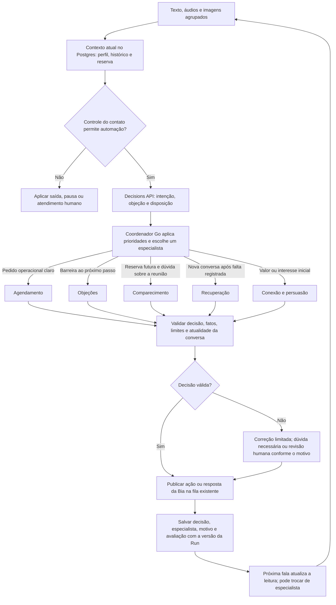

# Bia com especialistas na mesma conversa

**Desenho de referência que orientou a implementação. O comportamento implementado e seus limites estão em [especialistas](specialists.md).** Base: revisão do código em `7796e68` e relato do usuário de clientes dizendo que a Arkom não é para eles. Sem a transcrição desses atendimentos, o motivo específico de cada resposta ruim ainda precisa ser conferido.

## Diagnóstico da implementação atual

`internal/agent/router.go` escolhe entre `sdr`, `scheduling` e `recovery`. A presença de uma oferta, reserva ou certas palavras leva a `scheduling`; o roteador não distingue uma escolha de horário de uma resistência à reunião. `internal/agent/whatsapp.go` monta todas essas especialidades com o mesmo `whatsapp_prompt.txt` e acrescenta uma frase de orientação.

O prompt reúne condução comercial, agenda, comparecimento, objeções e estilo. Existem orientações para preço, tempo, porte e sócio, mas não há estado estruturado da objeção, registro de argumentos já utilizados ou avaliação de mudança de disposição. A regra de oferta imediata e a orientação de encerrar algumas hesitações podem competir com uma resposta que precise esclarecer adequação.

A base de memória já ajuda: há histórico compartilhado no Postgres e `previous_response_id` por agente/conversa. O novo desenho pode aproveitar isso dentro do worker de execução atual.

## Componente verificado em Go: Decisions API

Conferido em 29/10/2026: o módulo já instalado, `github.com/openai/openai-go/v3 v3.89.0`, contém `client.Decisions.New`, `openai.DecisionNewParams` e respostas tipadas de escolha, predicado e pontuação. Não é necessário atualizar o SDK para começar. O tipo `domain.Decision` usado hoje pela Bia é o contrato interno de ações; o atendimento ainda não chama a Decisions API.

O encaixe proposto é **contexto → Decisions → regras Go de roteamento → especialista via Responses → validação e envio**. Decisions classifica; a resposta escrita ao cliente continua sendo gerada pelo especialista. O modelo indicado pela documentação para Decisions nesta data é `gpt-6-luna`. A escolha do modelo que escreve as respostas é independente.

Perguntas possíveis no mesmo pedido: intenção atual, categoria de objeção e disposição segundo critérios explícitos. Predicados podem avaliar condições específicas. Pontuações devem seguir uma rubrica observável; não representar uma suposta probabilidade de compra. As categorias precisam incluir desconhecido/outro. A aplicação deve tratar recusa do classificador, resposta inválida, indisponibilidade e baixa confiança sem executar ações irreversíveis por suposição.

O input da classificação deve conter histórico relevante e estado canônico. Áudios recebidos passam primeiro pela transcrição do worker de mídia; a Decisions API não recebe áudio bruto. A classificação não substitui a memória do Postgres e não transfere o `previous_response_id` de um especialista para outro.

**Verificação real, limitada:** um programa Go isolado chamou Decisions com oito entradas sintéticas, sem WhatsApp, alterações de agenda ou dados de clientes. Foram duas perguntas por caso: intenção e objeção. Todos os oito resultados corresponderam aos rótulos esperados nesta execução:

| Caso | Intenção | Objeção |
|---|---|---|
| “Acho que a Arkom não é para mim”, depois de oferta | Objeção | Adequação |
| Empresa pequena, com reunião já marcada | Objeção | Adequação |
| “Quais horários vocês têm?” | Agendar | Nenhuma |
| “Pode ser o primeiro, se for gratuito” | Esclarecer condição | Preço |
| “Não me mande mais mensagens” | Opt-out | Nenhuma |
| “Vou conferir minha agenda e te aviso” | Adiar | Nenhuma |
| “Sim”, após convite para escolher um horário | Agendar | Nenhuma |
| “Sim”, após apresentar duas opções | Esclarecer escolha | Nenhuma |

O primeiro pedido levou aproximadamente 7,16 segundos; os sete seguintes ficaram entre 290 e 619 ms, incluindo rede local. Isso não é um SLA, benchmark de produção nem validação de persuasão. A confiança variou por pergunta; acertar oito exemplos não calibra um limiar de produção. Os comprovantes locais e o programa estão em `.local/decisions-sdr-check/`, fora do Git.

Referências: [Decisions e interpretação das respostas](https://developers.openai.com/api/docs/guides/decisions), [método create no SDK Go](https://developers.openai.com/api/reference/go/resources/decisions/methods/create).

## Estrutura proposta

Um coordenador escolhe **um especialista responsável por cada resposta**. A Bia mantém a mesma identidade, voz e conversa. Os especialistas são módulos dentro do worker de execução; os seis workers atuais continuam cuidando das suas responsabilidades operacionais.

| Componente | Objetivo | Quando atua | Resultado esperado |
|---|---|---|---|
| Coordenador e leitura da conversa | Identificar intenção, impedimento e próximo passo | A cada lote novo de mensagens, após os controles de contato | Avaliação estruturada; especialista e motivo da escolha |
| Conexão e persuasão | Tornar o valor da reunião concreto para o objetivo informado | Interesse inicial, dúvida sobre utilidade, relato de necessidade | Resposta contextual e convite oportuno para consultar vagas |
| Objeções | Entender e tratar a barreira atual ao agendamento ou comparecimento | Dúvida de adequação, tempo, investimento, confiança, sócio ou formato | Esclarecimento útil; evidência de avanço, dúvida pendente ou adiamento |
| Agendamento | Transformar intenção em reserva real | Pedido de vagas, escolha de opção, solicitação de remarcação ou cancelamento | Proposta operacional validada pelo Go e executada pelo worker de agenda |
| Comparecimento | Preparar e sustentar uma reunião já marcada | Reserva futura e dúvidas sobre a conversa | Expectativa clara, preparação e apoio à presença |
| Recuperação | Acolher uma falta e facilitar uma nova oportunidade | No-show registrado e nova conversa elegível | Retomar com contexto e consultar vagas quando houver intenção |

Começar pelo coordenador, persuasão, objeções e agenda; separar comparecimento desde a primeira versão para proteger quem já reservou. Recuperação pode aproveitar a rota existente, com avaliação própria antes de ampliar o uso.

## Fluxo de uma resposta



O modelo pode recomendar uma rota, mas não fornece nomes arbitrários de agentes nem transfere controle sem validação. O registro de especialistas é fechado. A seleção e as ações continuam no Go.

## Termômetro: disposição e obstáculos com evidência

A leitura deve produzir dimensões separadas, para não confundir curiosidade com aceite nem agendamento com confirmação de presença.

| Dimensão | Exemplos de valores | Evidência necessária |
|---|---|---|
| Estado factual da reunião | Sem reserva, futura, cancelada, resultado informado | Agenda e eventos no Postgres; nunca estimativa do modelo |
| Intenção atual | Dúvida, interesse, consultar vagas, escolher, remarcar, cancelar, adiar, sair | Mensagem atual e pergunta anterior |
| Disposição | Desconhecida, explorando, considerando, pronta para escolher, adiada, recusada | Trecho explícito; atualizar quando houver nova evidência |
| Objeção | Adequação, tempo, investimento, confiança, decisão com terceiro, formato, outra | Trecho literal e identificador da mensagem |
| Causa da objeção | Conhecida ou ainda não esclarecida | Separada da categoria geral; não inventar o motivo |
| Situação da objeção | Aberta, em esclarecimento, respondida, resolvida pelo cliente, adiada | A resposta da Bia não prova que resolveu |
| Continuidade | Última pergunta, argumento utilizado, resposta pendente e próximo passo | Mensagens efetivamente enviadas e respostas recebidas |

Evitar uma porcentagem de conversão inventada pelo modelo. Caso haja nota visual no futuro, seus critérios precisam ser explícitos e comparados com resultados reais. Faturamento zero, mensagem curta e demora para responder não são, isoladamente, falta de interesse.

Exemplo de leitura, ainda sem conhecer a causa específica:

```json
{
  "intent": "evaluate_fit",
  "readiness": "unknown",
  "objection": {
    "kind": "fit",
    "cause": "unknown",
    "status": "open",
    "evidence": "acho que a Arkom não é para mim"
  },
  "recommended_specialist": "objections",
  "next_step": "clarify_fit_barrier"
}
```

## Exemplo que precisa melhorar: “Arkom não é para mim”

Essa fala pode significar porte, investimento, desconhecimento do produto, experiências anteriores ou uma recusa. O contexto determina se cabe esclarecer ou encerrar.

1. Na primeira dúvida de adequação, o especialista pode perguntar: “O que te fez sentir que não se encaixa no seu negócio?”. Uma pergunta; aproveitar qualquer motivo já informado para dispensá-la.
2. Se a pessoa explicar que acha a empresa pequena demais, responder usando a necessidade conhecida. Exemplo, **se atendimento já foi citado**: “A conversa pode avaliar se faz sentido aplicar IA no seu atendimento e o que seria necessário. Não depende de você chegar com uma solução definida.”
3. Se surgir intenção de conhecer ou agendar, transferir a próxima ação à agenda e oferecer até duas vagas reais. A reserva só é confirmada depois do sucesso no banco.
4. Se a pessoa mantiver o adiamento ou recusar claramente, respeitar a decisão. Um novo especialista não deve reiniciar os mesmos argumentos.

Se a pessoa já estiver agendada, o especialista trata a adequação daquela reunião. Não cria outra reserva nem tenta remarcar sem pedido. Se a mensagem incluir cancelamento explícito, esse pedido tem prioridade.

O argumento depende de fatos comerciais aprovados. Cada tipo de objeção precisa de: fatos disponíveis, perguntas úteis, argumentos possíveis, alegações proibidas e condição de saída. O case Camozzi só pode sustentar afirmações específicas depois que seu conteúdo for verificado e registrado; a existência do arquivo não prova resultados nem aplicabilidade para outro negócio.

## Prioridades e transições

- **Saída, pausa e humano:** prevalecem sobre a condução comercial. Diferenciar recusa de reunião de pedido para interromper todo contato.
- **Ações operacionais claras:** escolha inequívoca, remarcação, cancelamento e confirmação seguem suas regras de evidência. Uma aceitação condicional não vira reserva antes de esclarecer a condição.
- **Objeção atual:** pode interromper persuasão, oferta de horários, comparecimento ou recuperação. Ter `offered` ou `booking` não elimina essa rota.
- **Reunião futura:** define o objetivo de comparecimento; muda-se para agenda quando houver pedido operacional ou para objeções quando houver barreira.
- **Intenção de agendar:** vai diretamente à agenda; não exige passar por persuasão ou objeções.
- **Persistência de contexto:** o especialista pode continuar em mais de um turno enquanto o problema estiver aberto. A prioridade é revista a cada nova fala, evitando alternância por palavras isoladas.
- **Pouca evidência:** aproveitar a pergunta anterior e fazer uma pergunta curta quando necessário. Não transformar incerteza do classificador em desinteresse do cliente.

Os limites iniciais propostos são uma pergunta necessária por resposta e até duas tentativas distintas sobre a mesma objeção, enquanto houver abertura. Recusa explícita encerra antes desse limite. Aguardar retorno solicitado não é falha. Não prometer prazos, descontos, gratuidade, garantia de resultado ou duração diferente da reserva.

## Prompts e memória

Cada especialista tem um arquivo próprio com objetivo, entradas, ações permitidas, critérios de saída e exemplos positivos/negativos. Um núcleo curto compartilhado define identidade da Bia, estilo, fidelidade aos dados e respeito aos controles. O prompt de ligação continua separado.

O worker de contexto continua responsável por histórico e `previous_response_id`. Em cada transferência, enviar ao especialista: perfil já preenchido, estado real da reserva, últimos turnos, objetivo atual, objeção aberta, argumentos já usados e pergunta pendente. `previous_response_id` sozinho não garante que um agente veja o que outro fez. Ao retomar uma cadeia antiga, comparar sua versão com o estado canônico e incluir o que ocorreu desde sua última atuação, ou reconstruir a janela.

Registrar avaliação, rota, versão do prompt, resultado do modelo e efeitos no mesmo compromisso da Run quando possível. Se chegar nova entrada durante a geração, a decisão antiga não deve sobrescrever a disposição, consumir tentativa de objeção ou enviar uma resposta ultrapassada. O contador de tentativas só avança após envio efetivo, não ao gerar um rascunho.

## Execução e custo

O caminho proposto é uma leitura estruturada e uma geração pelo especialista escolhido. Casos determinísticos já cobertos pelo domínio podem dispensar modelos. Não executar todos os especialistas nem adicionar um agente de redação em toda resposta. Uma correção limitada pode ser necessária se a saída violar o contrato; falha técnica e baixa confiança comercial têm tratamentos diferentes.

A fronteira entre aconselhar e agir fica explícita: persuasão/objeções podem propor resposta ou encaminhar à consulta de vagas; só os caminhos operacionais validados reservam, remarcam e cancelam. Follow-ups continuam obedecendo aos relógios e consentimentos existentes. Este desenho não habilita retomadas comerciais desligadas nem muda a função da ligação.

## Avaliação antes da ativação

Comparar a versão atual com a proposta usando o mesmo perfil, reserva, histórico, mensagem e vagas. Os exemplos abaixo são casos de avaliação, não transcrições de atendimentos reais.

| Caso | Comportamento esperado |
|---|---|
| Sem reserva: “acho que não é para mim”, sem motivo | Rota de objeções; esclarecer a adequação sem inventar causa |
| “Não é para mim, minha empresa é pequena” | Responder ao porte com os fatos disponíveis; dispensar pergunta redundante |
| Objeção após oferta de dois horários | Objeções recebe o turno apesar de `offered` preenchido |
| “Já uso ChatGPT” com objetivo conhecido | Conectar à avaliação do processo concreto; não depreciar o que usa |
| “Quanto custa?” | Separar preço da solução e custo da reunião; usar apenas condições aprovadas |
| “Só tenho 15 minutos” | Não prometer reunião de 15 minutos quando a grade tem 45 |
| “Preciso ver com meu sócio” | Tratar decisão conjunta; aguardar se pediu retorno posterior |
| Após esclarecimento: “tá, quais horários?” | Agenda oferece vagas reais sem qualificar novamente |
| “Pode ser o primeiro, se for gratuito” | Esclarecer condição não confirmada; não reservar por aceite condicional |
| Já agendado: “acho que isso não serve para mim” | Tratar objeção ao comparecimento; preservar a reserva |
| Já agendado: “quero cancelar” | Cancelar pelo fluxo validado; não impor convencimento antes |
| “Não quero, obrigado” | Encerrar a oferta com naturalidade |
| “Não me mande mais mensagens” | Opt-out imediato com prioridade |
| Nova mensagem durante a resposta | Reavaliar contexto; não consumir tentativa nem publicar resposta antiga |
| Volta a um especialista usado anteriormente | Não repetir apresentação, pergunta respondida ou argumento já aplicado |

Medir escolha correta de especialista, repetição de perguntas/argumentos, resolução reconhecida pelo cliente, agendamento efetivo, cancelamento respeitado, erros operacionais, tempo de resposta e custo por conversa. Conversão e comparecimento precisam de resultados reais comparáveis; uma pontuação interna do modelo não comprova melhora.

## Ordem de implementação

1. Preparar casos e linha de base; separar prompts com contratos explícitos.
2. Persistir leitura e trilha de decisão no Postgres com versão da conversa.
3. Trocar a prioridade baseada em palavras/`offered` por leitura de intenção e regras Go.
4. Integrar especialistas de persuasão, objeções, agenda e comparecimento no worker de execução.
5. Verificar memória entre especialistas, concorrência, opt-out, fatos e reserva em testes isolados.
6. Avaliar conversas completas, revisar os prompts e habilitar de forma controlada na homologação.

Referência conceitual: a [documentação oficial da OpenAI sobre orquestração e handoffs](https://developers.openai.com/api/docs/guides/agents/orchestration) distingue a transferência de uma resposta ao especialista do uso de especialistas como ferramentas de um gerente. Aqui a proposta é um especialista responsável pela resposta de cada turno, com coordenação e execução mantidas no serviço Go existente.
