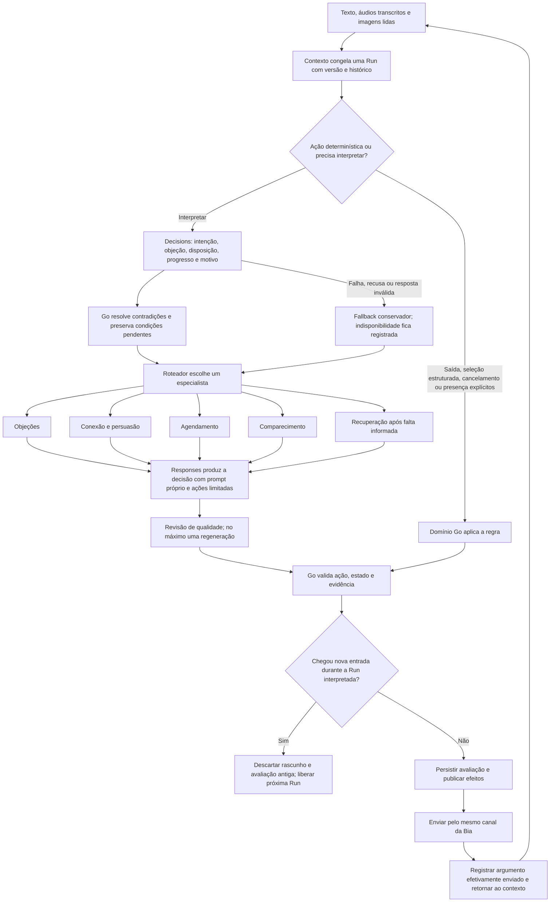

# Especialistas de texto e Decisions em Go

O prompt atual é `bia-specialists-v3`, de 29/10/2026. A [avaliação das conversas](conversation-qa-2026-10-29.md) registra a matriz sintética, falhas encontradas, correções e limites da homologação. Inclui direct response, contexto durante o intervalo da reunião, condições pendentes, preferência explícita de horários, pedido de humano e desistência da remarcação. A experiência no aparelho continua sendo uma validação complementar.

O atendimento pode classificar cada lote de mensagens com Decisions e escolher um especialista de texto no worker de execução. A Bia mantém a identidade, o número e o histórico compartilhado. Voz conserva o roteiro de lembrete separado.



## Ativação

```dotenv
BIA_SPECIALISTS_ENABLED=true
OPENAI_DECISIONS_MODEL=gpt-6-luna
```

O padrão local continua desativado. É exigida chave OpenAI configurada e o modelo suportado para Decisions. A geração continua com `OPENAI_MODEL`; o SDK permanece `openai-go/v3 v3.89.0`. Os prompts são embarcados no binário. Mudar arquivos requer build/publicação; nenhuma regra comercial é reescrita automaticamente pelo modelo.

Para rollback de comportamento, definir `BIA_SPECIALISTS_ENABLED=false` e recriar os serviços. O caminho anterior de prompt/roteador continua disponível. O JSON adicional no Postgres é compatível com os dados anteriores e não exige nova tabela ou remoção de conversas.

## Quem responde

| ID interno | Responsabilidade | Limite operacional |
|---|---|---|
| `persuasion` | Relacionar o objetivo conhecido ao valor da reunião | Resposta e oferta; não reserva diretamente |
| `objections` | Esclarecer a barreira ao agendamento ou comparecimento | Enquanto a barreira está aberta, não oferece vagas nem reserva |
| `scheduling` | Vagas, escolha, remarcação, cancelamento e presença | Mutações continuam validadas e executadas pelo worker de agenda |
| `attendance` | Preparação e dúvidas sobre uma reserva futura ou em andamento | Não abre outra oferta de reunião |
| `recovery` | Nova conversa após no-show registrado | Pode oferecer vagas; não infere falta pelo silêncio |

Pedidos operacionais claros têm prioridade. Uma oferta anterior não prende a conversa à agenda. Objeções podem ocorrer antes ou depois da reserva. Quem já tem reunião futura ou em andamento permanece no objetivo de comparecimento, exceto quando pede alteração ou apresenta barreira concreta. As especialidades são um registro fechado no Go; nomes ou comandos propostos pelo modelo não criam agentes.

Direct response orienta cada resposta comercial a conectar um benefício concreto ao objetivo conhecido e terminar com um próximo passo simples, quando houver abertura. Não adiciona urgência fictícia, resultado garantido ou insistência após saída. No início da reunião, o [worker de follow-up](followups.md) envia uma mensagem determinística com `CONFIRMO` ou `REMARCAR`; a resposta volta ao mesmo contexto. Durante o intervalo reservado, confirmação indica intenção de participar e não comprova presença. Atraso não autoriza prometer que o consultor irá esperar.

## Termômetro e memória

`leads.state.dialogue` guarda a avaliação atual, especialista, versão do prompt, evento/versão da conversa e dados comerciais de continuidade. O mesmo diagnóstico fica no resultado do job interpretado.

- `assessment`: intenção, categoria de objeção, disposição, progresso, presença de motivo concreto, origem, modelo, tokens e tempo de classificação.
- `confidence`: valores retornados pelo classificador, usados para observação; não são probabilidade de compra. Não há um limiar de produção calibrado com conversões reais.
- `adjusted`: campos cuja contradição foi resolvida pelo Go. A confiança original desse campo é removida para não atribuí-la ao valor corrigido.
- `objection`: evidência literal, motivo explicado, estado e até quatro registros recentes de tentativas efetivamente enviadas.
- `previous_objections`: até quatro objeções anteriores; não é um histórico comercial completo.
- `booking_condition`: condição de preço/duração ainda não confirmada. Uma simples seleção de horário não apaga a condição; a retirada explícita permite prosseguir.
- `last_question` e `last_response`: mensagens efetivamente enviadas, compartilhadas com o próximo especialista.

A instrução comercial limita insistência a duas tentativas distintas por objeção enquanto houver abertura. A memória guarda até quatro registros para continuidade e diagnóstico; esse armazenamento não autoriza insistência adicional. Responder a uma nova dúvida concreta é diferente de repetir o argumento.

Fragmentos de uma mesma resposta contam como uma tentativa, identificada pela Run. Rascunho, simulação e resposta descartada não consomem tentativa enviada. O motivo esclarecido não é substituído por um simples “sim” enquanto houver condição de reserva pendente.

## Heads e continuidade

O worker de contexto mantém `previous_response_id` separado por especialista. O head agora inclui `prompt_version`. Uma versão de prompt incompatível inicia outra cadeia, reconstruída com o contexto durável. Os limites existentes de idade, profundidade e tokens continuam valendo.

Toda chamada recebe perfil, reserva atual, histórico recente e memória comercial. Trocar de especialista não depende de compartilhar o response ID de outro agente. As instruções dizem para manter a voz da Bia, sem apresentação nova ou aviso de transferência interna.

Antes de confirmar uma Run interpretada, o banco verifica a versão da conversa e entradas pendentes sob trava. Se já houver entrada nova, restaura o estado anterior, descarta os efeitos e não publica o head do rascunho antigo. Antes do envio, a verificação existente contra nova entrada continua ativa para as mensagens em partes.

## Falhas e qualidade

Decisions tem prazo de oito segundos e uma tentativa por Run. Falha, recusa, categoria inválida ou resposta incompleta ativa interpretação conservadora com `source=decisions_unavailable`; isso sozinho não coloca o contato em atendimento humano. O fallback usa contexto e alguns sinais explícitos, sem fingir que houve classificação bem-sucedida.

As ações permitidas aparecem tanto no contexto como no JSON Schema por especialidade. Há guardas adicionais para aceite condicionado, adiamento sem pausa global, reserva existente, horários duplicados na introdução e “sim” diante de duas opções.

Na versão v3, um pedido de humano ou pausa não depende de o redator concordar com a classificação. Escolha literal validada pode seguir à agenda após retirada explícita de condição; novas condições continuam bloqueadas, incluindo as de formato. Um pedido de remarcação oferece opções reais antes de exigir escolha. Manter explicitamente o horário original invalida as opções anteriores de remarcação. Restrições literais de disponibilidade são aplicadas às vagas antes da oferta; subconjunto validado com uma única vaga não é completado com outra fora do período pedido. Diagnósticos internos longos são truncados em limites UTF-8 sem descartar uma resposta operacional válida.

A revisão de qualidade detecta repetição da pergunta sobre motivo já explicado, certas promessas de confirmação indisponíveis, afirmações de reserva/links que o domínio rejeitaria, termos internos e caracteres cirílicos inesperados na resposta. Permite **uma regeneração**, com instrução de correção. Se persistir, usa uma resposta conservadora e descarta o head do rascunho inadequado. Essas verificações não são uma avaliação semântica completa de persuasão ou de todas as alegações possíveis.

## Avaliação

Testes de unidade e integração cobrem o protocolo nativo Decisions, falhas e respostas inválidas, seleção de especialista, memória entre especialistas, isolamento/versionamento dos heads, condição pendente, revisão limitada e descarte de estado com nova entrada. O banco usado na suíte é somente `localhost/arkom_bia_test`.

A avaliação com API real usa apenas conversas sintéticas e passa pelo domínio Go, sem enviar WhatsApp ou reservar em um calendário de cliente. Inclui adequação → esclarecimento de porte → oferta → ordem de reserva, objeção com reserva existente → preparação, aceite condicionado, adiamento e escolha ambígua. Os comprovantes ficam em `.local/specialists-eval/`.

Acerto de rota/ação e preservação de invariantes não comprovam melhora de conversão. Texto ainda pode variar entre execuções. A próxima validação é a conversa no número de homologação; resultados reais devem orientar as próximas versões de prompt.

Fontes: [Decisions](https://developers.openai.com/api/docs/guides/decisions), [SDK Go](https://developers.openai.com/api/reference/go/resources/decisions/methods/create), [orquestração e handoffs](https://developers.openai.com/api/docs/guides/agents/orchestration).
