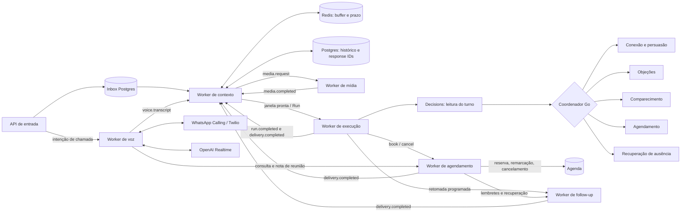

# Seis workers em Go

Implementação local, com comunicação persistente e execução independente. O n8n continua intacto.



## Responsabilidades

| Processo | O que faz | Código principal |
|---|---|---|
| Contexto | Agrupa fragmentos, espera mídia, monta janela limitada, publica a execução, persiste histórico canônico e heads por agente | `internal/contextworker`, `internal/store/context.go` |
| Execução | Seleciona agente, chama Responses API, valida decisões, envia respostas imediatas e publica comandos de agenda/cadência | `internal/worker`, `internal/agent` |
| Mídia | Baixa arquivos autorizados, transcreve áudio, extrai imagens/PDF/texto e devolve resultado | `internal/mediaworker`, `internal/providers/media.go` |
| Agendamento | Reserva, remarca, cancela, aplica eventos de agenda/presença e envia confirmação da reserva | `internal/schedulingworker` |
| Follow-up | Consome contatos programados, revalida horário e estado, envia retomadas, lembretes e recuperação | `internal/followupworker` |
| Voz | Gerencia autorização nativa, ligação WhatsApp, áudio Realtime e ferramentas | `internal/voiceworker` |

Voz tem fila própria em Postgres, sessão Realtime separada das Runs de texto e ferramentas que consultam a reunião e registram notas por meio do worker de agenda. A ligação atual não altera reservas. Consulte [autorização, configuração e limites](voice.md). O áudio usa WebSocket e o histórico confirmado é publicado para contexto.

A API é a porta de entrada HTTP. O mesmo binário tem modos separados de execução; `all` inicia os seis workers e a API para desenvolvimento. Cada agente usa o modelo configurado e instruções da sua especialidade. Com `BIA_SPECIALISTS_ENABLED=true`, Decisions classifica o turno e o Go escolhe entre cinco especialistas com prompts próprios. O histórico e a memória comercial são compartilhados; consulte [especialistas e limites](specialists.md). O roteamento legado continua disponível quando a opção está desligada.

Execução, agendamento e follow-up atualizam o estado comercial (`leads.state`) sob uma trava compartilhada por lead. Cada um consome apenas sua fila. Seu histórico curto é uma projeção legada. O histórico canônico das mensagens, referências de mídia e `previous_response_id` pertencem ao contexto. Essa separação é aplicada pelo código; os processos ainda compartilham a credencial de banco. Roles SQL com permissões por serviço não foram implementadas.

## Fluxo de uma mensagem

1. A API valida o evento, rejeita o campo interno `context` e grava a entrada no Postgres. O HTTP 202 confirma persistência, não entrega de resposta.
2. Contexto registra a mensagem original e atualiza no Redis os IDs dos fragmentos, a versão e o prazo de agrupamento. O texto permanece durável no Postgres.
3. A janela fecha após **5 segundos de silêncio**, com limite de **30 segundos** para tráfego contínuo. Esses valores estão em `DefaultWindowPolicy`.
4. Havendo anexos, contexto publica trabalho para mídia. A janela aguarda os resultados por até **120 segundos**. Erro ou timeout vira revisão humana explícita.
5. Contexto publica uma Run imutável: IDs das mensagens, texto agrupado, histórico recente, versão e heads. Há no máximo uma Run ativa por conversa. Entradas novas ficam para a próxima.
6. Execução usa Decisions e escolhe `persuasion`, `objections`, `scheduling`, `attendance` ou `recovery`, recebe a decisão e aplica as regras comerciais. A ativação é explícita; sem ela, usa as três rotas legadas. O agente `scheduling` conversa sobre agenda; o **worker** `scheduling` executa as mutações. Conclusão e efeitos são persistidos na mesma transação, com destino calculado pelo banco.
7. Contexto consome a conclusão e atualiza o head daquele agente. Mensagens de saída só entram no histórico canônico após o adaptador confirmar o envio. A simulação não cria mensagens ficticiamente entregues.

Os contratos estão em `internal/conversation/types.go`. `worker_tasks` transporta entradas/resultados de contexto e mídia; `jobs` transporta Runs e ações comerciais. São filas Postgres com leases, tentativas limitadas e confirmação transacional. Redis acelera o agrupamento, mas não é a única cópia das mensagens: sua indisponibilidade ativa a leitura dos prazos no Postgres. Não há um broker externo obrigatório nesta versão.

## Agendamento e follow-up

A migração 3 acrescenta `jobs.queue` como coluna calculada a partir do tipo de trabalho. Produtores não escolhem arbitrariamente o consumidor. Isso também classifica os jobs antigos sem mudar seu status ou prazo.

| Trabalho | Consumidor |
|---|---|
| Run conversacional, formulário, opt-out, transferência humana, respostas imediatas e CRM | `execution` |
| Reserva e remarcação (`book`), cancelamento (`cancel`) | `scheduling` |
| Eventos `booking.*`, `attendance.*`, `schedule.preference` | `scheduling` |
| Envio de confirmação da reserva | `scheduling` |
| Retomada comercial, lembrete e recuperação (`followup`, `reminder`, `recovery`) | `followup` |
| Retomada autorizada da cadência (`cadence.resume`) | `followup` |

A execução mantém acesso somente de leitura à disponibilidade. O worker de agendamento possui as operações de mutação do calendário. A API continua oferecendo consulta e cadastro de vagas locais. A confirmação de presença inferida da conversa continua validada no domínio pelo executor; confirmação de reserva só existe após sucesso do calendário ou evento confirmado do provedor.

As regras determinísticas do domínio produzem os prazos da cadência quando uma oferta ou reserva muda. O worker de follow-up assume o consumo desses trabalhos no instante devido. Reconfere consentimento, pausa, opt-out, atendimento humano, versão da oferta, reserva atual e prazo de validade. Refaz a verificação do fuso e horário de contato ao enviar; se necessário, adia o mesmo job sem gastar tentativas de provedor. Se o próximo horário permitido ultrapassar a validade ou a reunião, descarta a mensagem. Não inventa no-show a partir de silêncio.

Os seis processos usam o mesmo histórico de entrega. Agendamento e follow-up publicam `delivery.completed` para contexto após um envio confirmado. Ambos compartilham a implementação de entrega, limites e reconciliação com o executor, sem compartilhar suas filas. Follow-up não chama o modelo nem o calendário.

Há uma única trava por lead entre as três filas comerciais. Eventos vencidos preservam sua ordem de entrada entre filas; efeitos esperam todos os eventos vencidos do lead. Um cancelamento, remarcação ou opt-out já enfileirado é aplicado antes de um lembrete pendente. Não é possível revogar uma chamada externa já iniciada; resultados ambíguos ficam para reconciliação.

Para atualizar uma instalação local existente, encerre os processos antigos, execute o novo binário com `-migrate` e inicie os seis papéis. Não mantenha executores da versão antiga concorrendo com os novos: a versão antiga não conhece a separação de filas. A migração altera apenas o schema `bia_go` configurado.

## Janela de contexto e response IDs

Cada conversa tem um head separado por agente, contendo `response_id`, instante, profundidade e tokens de entrada. O identificador da conversa considera lead, modo (`shadow`/`live`) e `conversation_id` do provedor. Envie esse identificador de forma consistente no formulário e nas mensagens.

A janela inclui até **20 mensagens / 24.000 bytes** de histórico, além do perfil e estado comercial. Cada lote reúne até 32 mensagens / 16.000 bytes. Conteúdo individual acima do limite após extração é encaminhado para revisão; o original permanece registrado. O histórico completo fica no Postgres. Não existe sumarização automática de conversas antigas nesta etapa.

O head é descartado da próxima janela ao atingir 8 encadeamentos, 16.000 tokens de entrada observados ou 20 horas. São limites operacionais conservadores; o limite em bytes não é um contador exato de tokens. Ao reiniciar a cadeia, o agente recebe o histórico limitado e o estado comercial. Se a API rejeitar especificamente um `previous_response_id` inexistente, o executor tenta uma vez sem ele, preservando essa janela. Outros erros não são convertidos silenciosamente em sucesso.

Nas Runs com janela, o SDK usa `store: true` para encadear respostas. As instruções são reenviadas a cada chamada. O snapshot de histórico confirmado e o estado comercial também são reenviados: uma decisão anterior do modelo não comprova que sua mensagem chegou ao lead. Mídia usa `store: false` e não altera a cadeia conversacional. Referência: [estado de conversa na Responses API](https://developers.openai.com/api/docs/guides/conversation-state).

## Mídia

- Áudio: `OPENAI_AUDIO_MODEL`, transcrição pelo SDK.
- Imagens PNG/JPEG/WebP/GIF e PDF: `OPENAI_MEDIA_MODEL`, modelo compatível configurado explicitamente.
- Texto simples: leitura limitada a 16.000 bytes.
- Outros formatos: erro explícito e revisão após tentativas limitadas. Não há suporte a vídeo, conversão de DOCX ou armazenamento próprio dos binários.

Downloads exigem HTTPS, host autorizado em `BIA_MEDIA_HOSTS`, IP público, limite de 20 MiB e não seguem redirecionamentos. Mídia devolve somente texto de referência; não pode reservar reuniões nem enviar WhatsApp. URLs protegidas que exigem autenticação específica do provedor ainda precisam de adaptador.

## Executar separadamente

Configure `.env` a partir de `.env.example` e exporte as variáveis em cada terminal. O modo padrão continua sendo `shadow`.

```sh
docker compose up -d postgres redis
go build -o bin/bia ./cmd/bia
./bin/bia -migrate
```

Em sete terminais ou serviços distintos, com a mesma configuração de banco:

```sh
./bin/bia -role api
./bin/bia -role context
./bin/bia -role execution
./bin/bia -role media
./bin/bia -role scheduling
./bin/bia -role followup
./bin/bia -role voice
```

Para desenvolvimento em um único processo:

```sh
./bin/bia -role all
```

`BIA_WORKERS` define a concorrência de cada papel. O Compose sobe Postgres e Redis; os processos Go são iniciados pelos comandos acima. Ainda não existe implantação de produção nem supervisão desses processos configurada.

## Operação e validação

`GET /v1/metrics` inclui `context_pending`, `media_pending`, `worker_tasks_dead`, `active_runs` e `jobs_pending_by_queue` (`execution`, `scheduling`, `followup`). `GET /v1/jobs/{id}` informa o campo `queue`. Jobs de entrada concluídos significam que o contexto ingeriu a mensagem; uma Run separada registra a execução. As tabelas `conversation_runs` e `conversation_messages.run_id` relacionam os fragmentos à execução.

Leases impedem conclusões por um worker cujo prazo expirou. IDs externos não podem colidir com trabalhos internos. Entradas novas invalidam efeitos antigos antes do despacho; isso não permite desfazer uma mensagem já enviada ou uma chamada externa em andamento. Resultado de envio incerto continua exigindo reconciliação, sem reenvio automático cego.

Os testes exercitam Postgres real e o cliente go-redis contra miniredis. OpenAI e mídia são simuladas em HTTP local. A validação de conta/modelos, extração real, provedor WhatsApp, carga, retenção de dados e implantação continuam pendentes. Nenhuma chave de produção é necessária para os testes.
